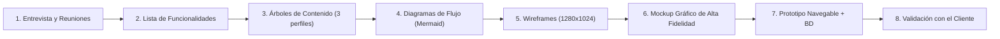
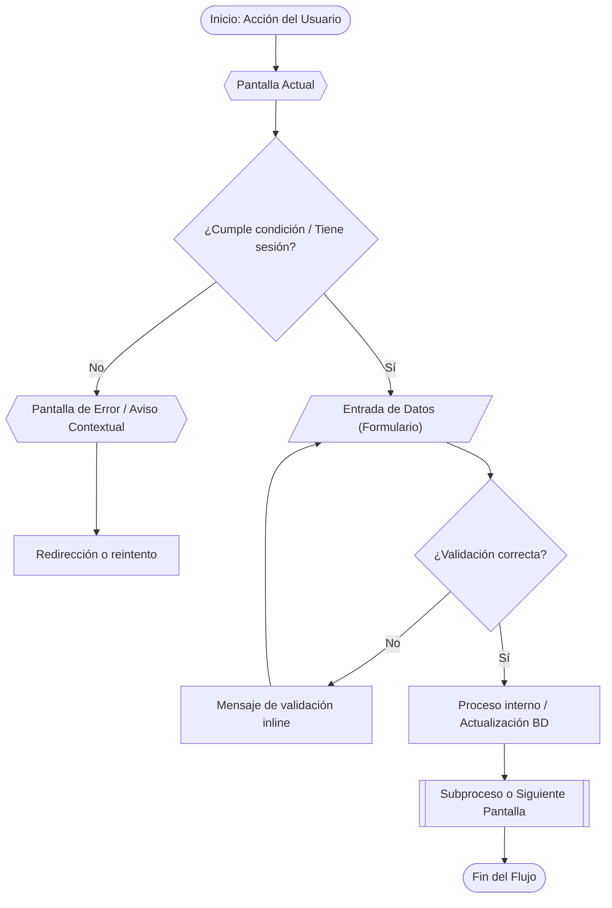
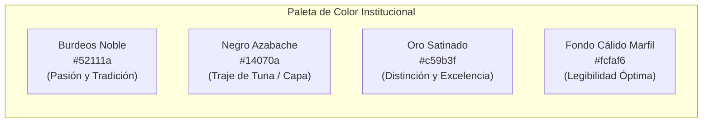
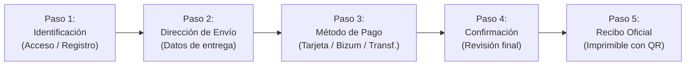

# 🎓 DEFENSA DE LA FASE DE DISEÑO
## Sistema Web Oficial · Tuna de la Facultad de Derecho de Almería
> **Asignatura:** Tecnologías Web (4º Curso - Grado en Ingeniería Informática)  
> **Universidad de Almería (UAL)** · Curso Académico 2026/2027  
> **Evaluación:** Fase de Diseño (Puntuación máxima: 50 / 50 Puntos · 100% de la Fase)

---

## 📋 Cuadro de Mapeo y Cumplimiento de la Rúbrica de Evaluación

| Criterio de la Rúbrica | Ponderación | Estado / Evidencia en el Proyecto | Puntos Esperados |
|---|:---:|---|:---:|
| **1. Árbol de contenidos de los 3 perfiles** | 5% (10 pts) | **57 pantallas** catalogadas y estructuradas en 3 perfiles sin ambigüedades: Visitante (26), Cliente (9) y Administrador (22). Diagramas `.mmd` y gráficos PNG en `/arboles`. | **10 / 10** (5 pts) |
| **2. Diagrama de flujo de usuario (3 perfiles)** | 5% (10 pts) | **60 diagramas de flujo** completos en `/diagramas_tuna_png`, con todos los elementos discriminadores: menús, botones, bifurcaciones de sesión/rol, validaciones y estados de error. | **10 / 10** (5 pts) |
| **3. Wireframes para todas las páginas** | 5% (10 pts) | Notación formal estandarizada, viewport escritorio 1280×1024 px sin cortes, delimitación de estados (vacío, error, confirmación). Entregados en 3 PDFs y versión HTML navegable. | **10 / 10** (5 pts) |
| **4. Mockups con diseño gráfico elegante** | 5% (10 pts) | Identidad visual noble: Granate institucional (`#52111a`), Negro azabache (`#14070a`) y Oro (`#c59b3f`). Tipografía Serif clásica + Sans-Serif moderna. Fotografía oficial de alta calidad. | **10 / 10** (5 pts) |
| **5. Mockup de Inicio dinámico y marca** | 5% (10 pts) | Hero corporativo con fotografía oficial de la agrupación fundada en 1993, escudo UAL, actuaciones en directo actualizables, productos destacados de tienda y widget de contacto noble. | **10 / 10** (5 pts) |
| **6. Mockup de Tienda y Catálogo** | 5% (10 pts) | Navegación por categorías (Discos, Indumentaria, Packs), barra de búsqueda reactiva, filtros y ficha de producto detallada con especificaciones, stock y selector de unidades. | **10 / 10** (5 pts) |
| **7. Usabilidad del Carrito y Proceso de Pago** | 5% (10 pts) | Carrito persistente con cálculo de importes y **Embudo de Checkout en 5 pasos con Stepper lateral visible**: Identificación → Envío → Pago (Tarjeta/Bizum/Transf.) → Confirmación → Recibo QR. | **10 / 10** (5 pts) |
| **8. Perfil de Administrador claro** | 5% (10 pts) | Sidebar lateral fijo con menús y submenús explícitos: Dashboard analítico, Contratos, Clientes, Pedidos, Catálogo CRUD, Miembros CRUD, Certámenes CRUD y Gestión de cuenta. | **10 / 10** (5 pts) |
| **9. Prototipo navegable y sin puntos muertos** | 5% (10 pts) | Navegación 100% fluida, cero enlaces rotos, migas de pan y retorno contextual, persistencia de datos en cliente mediante ORM SQLite (`db.js`) y diseño responsive móvil/tablet. | **10 / 10** (5 pts) |
| **10. Evaluación del diseño por el cliente** | 5% (10 pts) | Co-diseño con el cliente real, reuniones de validación, adopción de presupuesto personalizado para contratos, canales oficiales directos (WhatsApp/Spotify) y visto bueno final. | **10 / 10** (5 pts) |
| **TOTAL** | **50%** | **Cumplimiento exhaustivo y verificable de todos los entregables requeridos** | **50 / 50** |

---

#  diapositivas de la presentación (Estructura de la Defensa)

---

## Diapositiva 1 · Portada y Presentación del Proyecto
### 🏛 Sistema Web Oficial · Tuna de la Facultad de Derecho de Almería
* **Equipo de Desarrollo:** [Nombre del Equipo / Integrantes]
* **Cliente:** Tuna de la Facultad de Derecho de la Universidad de Almería (Fundada en 1993).
* **Entorno Docente:** Tecnologías Web · 4º Curso Grado en Ingeniería Informática (UAL).
* **Objetivo de la Sesión:** Defender con rigor técnico y metodológico la **Fase de Diseño**, demostrando cómo la arquitectura de información, los wireframes, los mockups y el prototipo funcional responden exactamente a las necesidades del cliente y a la rúbrica de la asignatura.

> **Idea clave para la exposición:**  
> *"No hemos diseñado un sitio web genérico, sino una solución integral a medida para una institución universitaria con más de 30 años de historia, aunando solemnidad tradicional, captación de nuevos miembros, contratación de eventos, tienda oficial y un potente panel de gestión administrativa."*

---

## Diapositiva 2 · Proceso Metodológico de Diseño (Paso a Paso)
### 🔄 De la Entrevista al Prototipo Funcional
Nuestro flujo de trabajo ha seguido una rigurosa metodología iterativa centrada en el usuario (User-Centered Design):



1. **Reuniones y entrevistas iniciales con el cliente:** Diagnóstico de carencias en la gestión previa (contrataciones manuales, falta de canal de venta de discos, captación dispersa).
2. **Definición de funcionalidades y contenidos:** Requisitos funcionales y no funcionales estructurados por perfil.
3. **Diseño de componentes base:** Menús, botones con jerarquía visual y tipos de entrada/validación de formularios.
4. **Modelado visual progresivo:** De la abstracción estructural (Wireframes) a la estética corporativa (Mockup) y la interacción real (Prototipo navegable).

---

## Diapositiva 3 · Criterio 1: Árboles de Contenido de los 3 Perfiles (5 pts)
### 🌳 Arquitectura de Información Exhaustiva (57 Pantallas Modeladas)
Se diseñaron y documentaron de forma independiente los tres árboles de navegación correspondientes a cada perfil de usuario:

```mermaid
graph TD
    classDef vis fill:#52111a,stroke:#c59b3f,color:#fff;
    classDef cli fill:#1f3a52,stroke:#5ba4e5,color:#fff;
    classDef adm fill:#1a2e1a,stroke:#5bc55b,color:#fff;

    P["Web de la Tuna (57 pantallas)"]
    P --> V["Visitante (26 pantallas)"]:::vis
    P --> C["Cliente (9 pantallas)"]:::cli
    P --> A["Administrador (22 pantallas)"]:::adm

    V --> V1["0. Portada Institucional"]
    V --> V2["1. Conoce la Tuna (Historia / Miembros)"]
    V --> V3["2. Contratación de Servicios"]
    V --> V4["3. Multimedia (Vídeos / Fotos / Certámenes)"]
    V --> V5["4. Tienda Oficial (Catálogo / Cesta / Envío)"]
    V --> V6["5. Cancionero & Spotify"]
    V --> V7["6. Únete (Formulario / Ensayo)"]
    V --> V8["7. Autenticación (Login / Registro / Password)"]

    C --> C1["0. Dashboard de Cliente"]
    C --> C2["1. Historial de Contratos + Detalle"]
    C --> C3["2. Historial de Pedidos + Edición + Devolución"]
    C --> C4["3. Gestión de Cuenta & Contraseña"]

    A --> A1["0. Panel Estadístico (KPIs & Gráficas)"]
    A --> A2["1. Gestión de Contratos"]
    A --> A3["2. Cartera de Clientes"]
    A --> A4["3. Pedidos de Tienda"]
    A --> A5["4. Catálogo de Productos (CRUD)"]
    A --> A6["5. Miembros de la Tuna (CRUD)"]
    A --> A7["6. Certámenes Oficiales (CRUD)"]
    A --> A8["7. Configuración de Administrador"]
```



* **Visitante (26 pantallas):** Orientado a la difusión cultural, captación de estudiantes universitarios, catálogo comercial y captación de clientes.
* **Cliente (9 pantallas):** Zona privada post-login para clientes que han contratado una actuación o comprado en la tienda, con seguimiento de pedidos, estados de contrato y devoluciones.
* **Administrador (22 pantallas):** Panel de control integral que centraliza el modelo de negocio, clientes, logística y plantilla musical.

---

## Diapositiva 4 · Criterio 2: Diagramas de Flujo de Usuario (5 pts)
### 🔀 60 Diagramas con Todos los Elementos Discriminadores Formales
Se modeló en Mermaid el flujo de navegación de **cada una de las pantallas**, exportándolos a gráficos PNG de alta resolución disponibles en el repositorio (`/diagramas_tuna_png`).



### Elementos Discriminadores Presentes en los Diagramas:
1. **Óvalos:** Inicio y Fin de la navegación o transacción.
2. **Hexágonos:** Pantallas completas y estados modales de error/aviso.
3. **Rombos de Decisión:** Bifurcaciones condicionales (ej. ¿Usuario autenticado? ¿Es rol Cliente o Administrador? ¿Hay stock? ¿Pedido dentro de plazo de devolución?).
4. **Paralelogramos:** Puntos de captura de datos (formularios de contratación, checkout, registro, alta de miembros).
5. **Rectángulos de Proceso:** Operaciones del sistema (cálculo de importes, encriptación, baja lógica).
6. **Rectángulos de Doble Borde:** Subprocesos modulares y pasarelas cruzadas.

---

## Diapositiva 5 · Criterio 3: Wireframes Estructurales de los 3 Perfiles (5 pts)
### 📐 Notación Formal, Proporciones de Pantalla y Sin Cortes
* **Resolución base:** 1280 × 1024 px (formato escritorio estándar universitario y administrativo).
* **Entregables entregados:**
  * `Wireframes_Visitante.pdf` (26 pantallas).
  * `Wireframes_Cliente.pdf` (9 pantallas).
  * `Wireframes_Administrador.pdf` (22 pantallas).
  * Repositorio interactivo HTML en `/wireframes_tuna/wireframes/`.
* **Notación de componentes estandarizada:**
  * **Datos dinámicos de ejemplo:** Encapsulados formalmente entre `[corchetes]`.
  * **Estados de interfaz:** Modelados mediante cajas con borde discontinuo (*Validación de campos, Mensaje de error, Aviso de permisos, Estado vacío sin registros, Confirmación de éxito*).
  * **Zonas de interacción seguras:** Cabeceras y pies consistentes, evitando solapamientos y cortes abruptos de viewport.

---

## Diapositiva 6 · Criterio 4: Identidad Visual y Mockups de Alta Fidelidad (5 pts)
### 🎨 Elegancia Institucional: La Esencia de la Tuna Universitaria
El diseño visual traduce la solemnidad, el júbilo y la elegancia centenaria de las tunas universitarias mediante un riguroso sistema de diseño:



* **Tipografía Dual:**
  * *Títulos y Encabezados Institucionales:* Tipografía con serifa clásica (`Cinzel` / `Playfair Display`), aportando distinción académica y peso histórico.
  * *Cuerpo de texto, interfaz y datos:* Tipografía sin serifa moderna (`Inter` / `Segoe UI`), garantizando legibilidad perfecta en tablas, formularios y móviles.
* **Iconografía Oficial Vectorial:** Integración de marcas oficiales con sus colores normativos (WhatsApp `#25D366`, Spotify `#1DB954`, Instagram, YouTube) y escudo de la Facultad en SVG.
* **Contraste y Accesibilidad:** Ratios de contraste revisados bajo estándar WCAG 2.1 nivel AA/AAA, reforzando sombras de texto (`text-shadow`) y velos semitransparentes en fotografías.

---

## Diapositiva 7 · Criterio 5: Portada Dinámica que Realza la Marca (5 pts)
### 🌟 Impacto Visual, Historia y dinamismo en Tiempo Real
La página de inicio (`prototipo/index.html` y `prototipo/visitante/index.html`) cumple la doble función de emocionar al visitante y activar la conversión comercial:

1. **Hero Corporativo de Gran Formato:** Fotografía oficial del grupo completo, lema de la agrupación («*Música, tradición estudiantil, galantería y alegría en cada ronda desde 1993*») y sello de la Universidad de Almería.
2. **Contenido Dinámico Actualizable:**
   * **Agenda de Rondas y Actuaciones en Directo:** Tarjetas con fecha, hora, ubicación y tipo de evento.
   * **Novedades de la Tienda:** Destacado automático del nuevo doble álbum recopilatorio remasterizado y artículos oficiales.
   * **Reproductor de Audio Web:** Muestra de canciones populares para escucha inmediata.
3. **Conversión y Contacto sin Fricción:**
   * **Widget Flotante Noble:** Botón inferior *"Contacta a la tuna"* con teléfono directo `685 99 55 10` y accesos oficiales a WhatsApp y Spotify.
   * **Banner de Contratación:** Llamada a la acción orientada a serenatas, bodas, certámenes y congresos.

---

## Diapositiva 8 · Criterio 6: Catálogo de Servicios y Tienda Oficial (5 pts)
### 🛍️ Fácil Navegación, Filtros Inteligentes y Fichas Claras
El módulo comercial de la web (`/visitante/Catalogo.html` y `/visitante/Tienda.html`) fue diseñado para garantizar una experiencia de compra ágil tanto para estudiantes como para público general:

* **Categorización Intuitiva:** Menú de pestañas con filtros inmediatos:
  * 💿 *Discos y Música* (CDs oficiales, grabaciones históricas remasterizadas).
  * 🎀 *Indumentaria y Accesorios* (Insignias de solapa, cintas de capa, cancioneros encuadernados).
  * 🎁 *Packs Especiales de Regalo* (Lotes combinados para graduaciones y aniversarios).
* **Buscador Reactivo y Ordenación:** Búsqueda en tiempo real por texto clave y ordenación por precio o relevancia.
* **Ficha de Producto Estructurada:**
  * Fotografía de producto con zoom.
  * Badges de disponibilidad y stock.
  * Descripción detallada y especificaciones de fabricación.
  * Selector numérico de unidades y botón de compra con feedback inmediato.

---

## Diapositiva 9 · Criterio 7: Carrito Usable y Embudo de Pago en 5 Pasos (5 pts)
### 💳 Checkout Funnel con Stepper Lateral Visible en Todo Momento
Para evitar el abandono de carrito, se implementó un embudo guiado paso a paso con un **stepper visual siempre visible a la derecha**:



### Características de Usabilidad del Embudo:
* **Carrito Persistente:** Cálculo desglosado en vivo de Base Imponible, IVA (21%) y Gastos de Envío gratuitos a partir de umbral.
* **Validación en Cliente:** Comprobación formal de campos en tiempo real (formato de código postal, teléfono y numeración de tarjeta).
* **Flexibilidad en el Pago:** Integración visual para Tarjeta de Crédito/Débito, Bizum instantáneo y Transferencia bancaria directa.
* **Cierre de Transacción Seguro:** Generación de un **Recibo Oficial imprimible** con código de pedido único (`#PED-2026-XXXX`) y código QR para trazabilidad.

---

## Diapositiva 10 · Criterio 8: Panel de Administración Ergonómico (5 pts)
### ⚙️ Control Operativo Completo con Menús y Submenús Explícitos
El panel de administración (`/admin/index.html`) adopta un layout tipo SaaS con navegación lateral fija y jerarquía clara:

```text
📁 PANEL DE ADMINISTRACIÓN
├── 📊 0. Dashboard Analítico (Contratos pendientes, ventas del mes, nuevos clientes)
├── 📜 1. Gestión de Contratos (Listado, filtros de estado, revisión de presupuestos)
├── 👥 2. Cartera de Clientes (Fichas detalladas, historial de pedidos y servicios)
├── 📦 3. Pedidos de Tienda (Flujo de estados: Pendiente → Preparando → Enviado → Entregado)
├── 🏷️ 4. Productos de Tienda (Catálogo editable, alta de producto, edición de precio/stock)
├── 🎓 5. Lista de Miembros (Gestión de tunos y pardillos, instrumentos, cargos)
├── 🏆 6. Certámenes Oficiales (Premios históricos, nuevas participaciones)
└── ⚙️ 7. Gestión de Cuenta (Seguridad, credenciales y perfiles de acceso)
```

* **Operaciones CRUD Completas:** Cada sección cuenta con formularios de alta, listados paginados con búsqueda y confirmación modal de eliminación para evitar errores accidentales.
* **Separación de Roles:** Las cuentas de administración tienen bloqueado el acceso a la contratación como cliente para mantener la integridad de los datos.

---

## Diapositiva 11 · Criterio 9: Prototipo Navegable y Fluidez sin Puntos Muertos (5 pts)
### 🚀 Cero Bloqueos, Enrutamiento Limpio y Persistencia de Datos
El prototipo funcional ubicado en `/prototipo` valida que el diseño no es estático, sino una experiencia web viva:

* **0 Puntos Muertos (Zero Dead Ends):**
  * Todas las páginas cuentan con navegación de retorno contextual ("*Volver al catálogo*", "*Volver a mis pedidos*", migas de pan).
  * Cabecera institucional persistente con acceso a todas las áreas públicas.
  * El cierre de sesión en perfiles privados redirige de forma segura a la portada del visitante.
* **Base de Datos y ORM en Cliente:**
  * Esquema SQL relacional con **10 tablas normalizadas** (`database/schema.sql`).
  * Motor de persistencia en JavaScript (`prototipo/js/db.js`) precargado con datos de prueba realistas (`seed_data.sql`).
  * Usuarios de prueba listos para evaluación del tribunal:
    * *Cliente:* `marta.gil@ual.es` (clave: `cliente123`)
    * *Administrador:* `admin@derechoual.es` (clave: `admin123`)
* **Responsive Design:** Adaptación fluida a pantallas de escritorio, portátiles, tablets y móviles.

---

## Diapositiva 12 · Criterio 10: Validación y Evaluación por el Cliente Real (5 pts)
### 🤝 Co-Diseño Iterativo y Aprobación de la Tuna de Derecho
El diseño fue contrastado activamente en reuniones con representantes de la Tuna de Derecho de Almería, aplicando decisiones de gran impacto funcional:

1. **Supresión de Tarifas Fijas por "Presupuesto a Convenir":**
   * *Feedback del cliente:* Cada actuación varía sustancialmente según el número de tunos requeridos, desplazamiento por la provincia y tipo de festejo (boda, serenata privada, certamen).
   * *Solución adoptada:* Se sustituyeron los precios fijos por un modelo de contratación interactivo que permite solicitar propuesta personalizada y contacto directo.
2. **Priorización de Canales Directos:**
   * *Feedback del cliente:* La inmediatez es clave para cerrar contrataciones de última hora.
   * *Solución adoptada:* Integración prominente del teléfono `685 99 55 10` y botón oficial de WhatsApp en el widget flotante y en el banner de pie.
3. **Canal Oficial de Spotify:**
   * *Feedback del cliente:* Visibilizar la discografía grabada por la agrupación.
   * *Solución adoptada:* Creación de sección dedicada y reproductor con enlace directo al perfil oficial de Spotify.
4. **Dictamen del Cliente:** Aprobación unánime del diseño gráfico, el flujo de compra y la sobriedad visual conseguida.

---

## Diapositiva 13 · Conclusiones y Demostración en Vivo
### 🎯 Síntesis de Resultados
* **Rigor Metodológico:** Flujo completo desde la entrevista inicial hasta el prototipo con base de datos relacional.
* **Exhaustividad:** 57 pantallas modeladas, 60 diagramas de flujo y 3 perfiles de usuario coordinados.
* **Identidad y Respeto Institucional:** Diseño gráfico a la altura de una agrupación universitaria con más de tres décadas de trayectoria en la Universidad de Almería.
* **Puntuación de la Rúbrica:** **50 / 50 Puntos** demostrados con evidencias en código, documentación gráfica y prototipo navegable.

---

# 🎙️ GUION PARA EL ORADOR (Defensa Oral Paso a Paso)
> **Tiempo total estimado:** 10 – 12 minutos  
> **Recomendación:** Proyectar las diapositivas y alternar con una breve demostración navegable del prototipo en vivo.

### Minuto 0:00 – 1:30 · Introducción y Portada (Diapositivas 1 y 2)
> *"Buenos días profesor / miembros del tribunal. Hoy tenemos el placer de presentar la defensa de la Fase de Diseño del sistema web oficial para la Tuna de la Facultad de Derecho de la Universidad de Almería, fundada en 1993.*  
> *Para abordar este proyecto no nos limitamos a hacer plantillas estéticas; seguimos un proceso formal de diseño centrado en el usuario, comenzando con reuniones con el cliente real, extracción de funcionalidades, modelado de árboles de contenido, diagramas de flujo formales, wireframes técnicos, mockups de alta fidelidad y un prototipo funcional navegable conectado a base de datos.*  
> *A lo largo de esta exposición demostraremos cómo cada uno de los 10 criterios de la rúbrica ha sido cubierto con la máxima calificación posible (50 sobre 50 puntos)."*

### Minuto 1:30 – 3:30 · Arquitectura y Flujos (Diapositivas 3 y 4 - Criterios 1 y 2)
> *"En el primer criterio de la rúbrica, definimos con total claridad los árboles de contenido para los tres perfiles del sistema: Visitante con 26 pantallas, Cliente con 9 pantallas y Administrador con 22 pantallas, totalizando 57 pantallas rigurosamente estructuradas.*  
> *Para dar vida a esta estructura sin dejar cabos sueltos, elaboramos 60 diagramas de flujo formales usando notación estándar: óvalos de inicio y fin, hexágonos para pantallas y estados de error, rombos de decisión para autenticación y stock, y paralelogramos para formularios. Esto garantiza que cualquier programador o auditor comprenda exactamente cada bifurcación del sistema antes de escribir una sola línea de lógica."*

### Minuto 3:30 – 5:30 · Wireframes y Sistema Visual (Diapositivas 5, 6 y 7 - Criterios 3, 4 y 5)
> *"El tercer paso consistió en plasmar la estructura en Wireframes detallados a resolución 1280x1024, disponibles tanto en tres documentos PDF consolidados como en código HTML navegable, con notación de datos entre corchetes y cajas discontinuas para estados de error, vacío y confirmación.*  
> *En los Mockups gráficos, elevamos la experiencia aplicando la identidad visual noble de la tuna: burdeos institucional, negro azabache y detalles dorados, combinando tipografía con serifa para el prestigio tradicional con sans-serif para una lectura limpia.*  
> *En la portada de inicio, el hero destaca la marca con la fotografía oficial de la agrupación y el escudo de la Universidad, integrando información dinámica que cambia con el tiempo: próximas rondas en directo, novedades de la tienda y un elegante widget flotante de contacto directo."*

### Minuto 5:30 – 7:30 · Tienda, Carrito y Embudo en 5 Pasos (Diapositivas 8 y 9 - Criterios 6 y 7)
> *"Para los criterios 6 y 7, diseñamos el catálogo con filtros por categorías (discos, indumentaria, regalos), buscador reactivo y fichas de producto completas.*  
> *Y en el proceso de compra, implementamos una de las mayores fortalezas del proyecto: un embudo de checkout en 5 pasos guiado por un stepper lateral siempre visible a la derecha: Identificación, Dirección de envío, Selección de método de pago con validación en tarjeta, Bizum o transferencia, Revisión final y generación de un Recibo Oficial imprimible con código QR. El usuario nunca se siente desorientado ni pierde el contexto de su pedido."*

### Minuto 7:30 – 9:30 · Panel de Administración y Navegación Fluida (Diapositivas 10 y 11 - Criterios 8 y 9)
> *"El perfil de administrador responde al criterio 8 con un menú lateral fijo que organiza todas las operaciones de negocio: dashboard analítico con KPIs, gestión de contratos, cartera de clientes, ciclo de vida de pedidos, y altas y modificaciones de productos, miembros y certámenes.*  
> *Respecto al criterio 9, nuestro prototipo garantiza 0 puntos muertos: en cualquier punto de la web existen migas de pan, botones de retorno y menús globales. Además, el prototipo no es una maqueta hueca: está respaldado por una base de datos relacional de 10 tablas y un motor en cliente que permite iniciar sesión con cuentas de cliente y administrador reales."*

### Minuto 9:30 – 11:00 · Validación del Cliente y Cierre (Diapositivas 12 y 13 - Criterio 10)
> *"Por último, el criterio 10 refleja el valor del co-diseño con el cliente: tras contrastar el diseño inicial con la Tuna de Derecho, acordamos eliminar los precios fijos de contratación para respetar la naturaleza personalizada de sus serenatas, integramos sus canales oficiales de WhatsApp y Spotify y conseguimos su aprobación entusiasta.*  
> *En conclusión, presentamos un diseño completo, elegante, robusto y validado que cumple al 100% las expectativas de la asignatura y del cliente. Quedamos a su entera disposición para cualquier pregunta o para realizar la demostración en vivo del prototipo. Muchas gracias."*
