# Contexto del proyecto para diseñar el mockup — Web de la tuna

> Archivo de contexto pensado para dárselo a una persona o a una IA que vaya a **diseñar el mockup visual** de la web.
> Reúne, en un único documento: qué es la web, quién la usa, los **árboles de contenido**, los **diagramas de flujo** y la descripción de cada **wireframe**.
> Todo lo que aquí aparece sale de los tres árboles de contenido que aportó el cliente y de los diagramas y wireframes que se derivaron de ellos.

## Cómo leer este archivo

1. **Parte A (secciones 1–7):** visión general, perfiles, árboles de contenido, reglas de navegación, patrones de interfaz y el encargo del mockup. Si solo tienes tiempo para una parte, lee esta.
2. **Parte B (sección 8):** una ficha por pantalla (57 en total) con su wireframe descrito, su diagrama de flujo y de dónde se llega a ella.
3. **Parte C (secciones 9–10):** contenido que hay que aportar, decisiones abiertas y observaciones sobre los árboles.

Convenciones:
- **Nodo**: número de la pantalla en el árbol de contenido (`4.2.1` = Cesta → iniciar sesión o registrarse para realizar pedido).
- Los textos entre **[corchetes]** en los wireframes son datos de ejemplo, no contenido final.
- Idioma de la web: **español (España)**.
- Los wireframes están dibujados para **escritorio, 1280 × 1024 px**. No existe versión móvil definida.

---

## 1. De qué trata la web

Sitio web de una **tuna universitaria** (agrupación musical). Cumple seis funciones:

| Función | Qué ofrece |
|---|---|
| Presentación | Historia de la tuna y ficha de sus miembros. |
| Contratación | Un cliente puede solicitar los servicios de la tuna (rondas, actuaciones) con un formulario. Exige cuenta de cliente. |
| Contenido multimedia | Vídeos, fotos y certámenes en los que ha participado. |
| Tienda | Catálogo de productos, cesta y pedido con dirección de envío. Exige cuenta para realizar el pedido. |
| Cancionero | Repertorio de canciones y enlace al perfil de Spotify. |
| Captación | Formulario para unirse a la tuna y datos del local de ensayo. |

Además hay **cuentas de usuario**: registro, inicio de sesión, recuperación de contraseña, un **área de cliente** y un **panel de administración** con estadísticas.

Nombre de la tuna, logo, colores y fotografías: **no facilitados todavía** (ver sección 9).

## 2. Perfiles de usuario

| Perfil | Quién es | Qué puede hacer | Pantalla de inicio |
|---|---|---|---|
| **Visitante** | Persona sin sesión iniciada | Navegar por toda la parte pública, rellenar el formulario para unirse, llenar la cesta, registrarse o iniciar sesión | `Inicio visitante` (nodo 0) |
| **Cliente** | Usuario registrado que contrata servicios o compra en la tienda | Ver su historial de contratos y de pedidos (con detalle), editar datos de un pedido, tramitar devoluciones, gestionar su cuenta | `Inicio de cliente` (nodo 0) |
| **Administrador** | Persona de la tuna que gestiona la web | Gestionar contratos, cartera de clientes, pedidos, productos, miembros, certámenes y su cuenta; ver estadísticas | `Panel de administración con estadísticas` (nodo 0) |

### Paso entre perfiles (inicio de sesión, nodo 7)

Tras iniciar sesión correctamente, el destino depende de **de dónde viene el usuario**:

| Origen | Destino |
|---|---|
| Venía de «Contratación» (2.1) | Formulario de contratación (2.1.1). Solo las cuentas de **cliente** pueden contratar; con cuenta de administrador se muestra un aviso. |
| Venía de la «Cesta» (4.2.1) | Dirección de envío (4.2.1.1) |
| Acceso directo y cuenta de **cliente** | Inicio de cliente |
| Acceso directo y cuenta de **administrador** | Panel de administración |

«Cerrar sesión» (cliente y administrador) devuelve al inicio del visitante.

## 3. Árboles de contenido

Numeración y nombres exactos de las pantallas (tomados de los `.mmd`). Las pantallas 2.1.1 y 4.2.1.1 del visitante **no aparecen en el árbol original**; se añadieron porque los diagramas de flujo las necesitan (ver sección 10).

### 3.1 Árbol del visitante

- 0 Inicio visitante
- 1 Conoce la tuna
  - 1.1 Historia
  - 1.2 Miembros
- 2 Contratación de nuestros servicios
  - 2.1 Inicio de sesión para contratación
    - 2.1.1 Rellenar formulario de contratación
- 3 Contenido multimedia
  - 3.1 Nuestros mejores momentos
    - 3.1.1 Vídeos
    - 3.1.2 Fotos
  - 3.2 Certámenes
- 4 Tienda
  - 4.1 Catálogo
  - 4.2 Cesta
    - 4.2.1 Iniciar sesión o registrarse para realizar pedido
      - 4.2.1.1 Dirección de envío
- 5 Cancionero
  - 5.1 Nuestro repertorio de canciones
  - 5.2 Escúchanos en Spotify
- 6 Únete a nosotros
  - 6.1 Formulario para unirse
  - 6.2 Local de ensayo
- 7 Inicio de sesión
  - 7.1 Recuperar contraseña
  - 7.2 Registrarse

<details><summary>Código Mermaid del árbol (00_arbol_visitante.mmd)</summary>

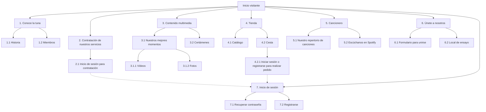

</details>

### 3.2 Árbol del cliente

- 0 Inicio de cliente
- 1 Ver historial de contratos
  - 1.1 Ver contrato en detalle
- 2 Ver historial de pedidos
  - 2.1 Ver pedido en detalle
    - 2.1.1 Editar datos del pedido
    - 2.1.2 Tramitar devolución
- 3 Gestionar cuenta
  - 3.1 Modificar información personal
  - 3.2 Cambiar contraseña

<details><summary>Código Mermaid del árbol (00_arbol_cliente.mmd)</summary>

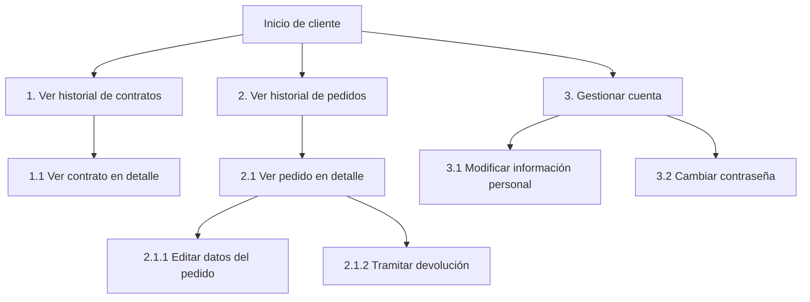

</details>

### 3.3 Árbol del administrador

- 0 Panel de administración con estadísticas
- 1 Gestionar contratos
  - 1.1 Ver contrato en detalle
- 2 Gestionar cartera de clientes
  - 2.1 Ver ficha de cliente
    - 2.1.1 Ver contratos del cliente
    - 2.1.2 Ver pedidos del cliente
- 3 Gestionar pedidos de la tienda
  - 3.1 Ver pedido en detalle
- 4 Gestionar productos de la tienda
  - 4.1 Añadir producto
  - 4.2 Modificar o eliminar producto
- 5 Gestionar lista de miembros
  - 5.1 Modificar o eliminar miembro existente
  - 5.2 Añadir nuevos miembros
- 6 Gestionar cuenta
  - 6.1 Modificar información personal
  - 6.2 Cambiar contraseña
- 7 Gestionar certámenes
  - 7.1 Modificar o eliminar certamen existente
  - 7.2 Crear nuevo certamen

<details><summary>Código Mermaid del árbol (00_arbol_admin.mmd)</summary>

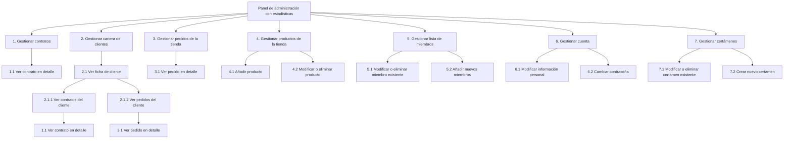

</details>

## 4. Mapa de navegación

**Visitante.** La cabecera tiene: logo → inicio; menú «Conoce la tuna · Contratación · Multimedia · Tienda · Cancionero · Únete»; a la derecha «Cesta (n)», «Iniciar sesión» y el botón destacado «Contratar» (→ Contratación). El inicio muestra seis tarjetas (nodos 1–6) y un bloque «¿Queréis contratarnos?». El inicio de sesión (nodo 7) solo se alcanza desde la cabecera y desde los avisos «inicia sesión para…».

**Cliente.** Cabecera con logo, menú «Inicio · 1 Contratos · 2 Pedidos · 3 Cuenta», nombre del cliente y «Cerrar sesión».

**Administrador.** Cabecera con logo, texto «Panel de administración», nombre del administrador y «Cerrar sesión». **Barra lateral fija** con: Panel de estadísticas, 1 Contratos, 2 Cartera de clientes, 3 Pedidos de la tienda, 4 Productos de la tienda, 5 Lista de miembros, 6 Cuenta, 7 Certámenes.

**Pie de página** (visitante y cliente): Contacto (correo, teléfono), Síguenos (Instagram · YouTube · Spotify), Legal (aviso legal, política de privacidad, política de cookies) y, solo en el visitante, «Únete → Formulario para unirse (6.1)». El administrador no lleva pie.

**Banner de cookies:** solo en el inicio del visitante, sobre el pie, con «Configurar», «Rechazar» y «Aceptar todas».

## 5. Patrones de pantalla repetidos (para diseñar componentes)

| Patrón | Dónde se usa | Descripción |
|---|---|---|
| **Pantalla-menú (hub)** | Conoce la tuna, Multimedia, Mejores momentos, Tienda, Cancionero, Únete; en admin: Productos, Miembros, Cuenta, Certámenes; en cliente: Cuenta | Título + subtítulo + imagen de cabecera (opcional) + 2 tarjetas grandes con imagen, título y descripción que llevan a los nodos hijos |
| **Lista + ficha** | Miembros, Certámenes, Catálogo (visitante); gestionar productos / miembros / certámenes (admin) | Lista o rejilla a la izquierda y panel de detalle a la derecha (340–380 px). En admin el panel es un formulario editable con «Guardar cambios», «Eliminar» y confirmación de borrado |
| **Listado en tabla** | Contratos, clientes, pedidos, repertorio, historiales del cliente | Barra de búsqueda (+ filtro de estado), tabla con enlace «Ver detalle» por fila, paginación y estado vacío |
| **Detalle con cambio de estado** | Contrato y pedido en detalle (admin) | Datos a la izquierda; a la derecha lista desplegable de estado + «Guardar estado» + confirmación |
| **Formulario** | Contratación, dirección de envío, unirse, registro, recuperar contraseña, datos personales, cambiar contraseña, añadir producto / miembro / certamen, editar pedido, devolución | Panel con campos en 1 o 2 columnas, casilla de aceptación cuando procede, botón principal + «Cancelar». Estados: error de validación junto al campo y mensaje de confirmación |
| **Puerta de acceso** | 2.1 Inicio de sesión para contratación, 4.2.1 Iniciar sesión o registrarse para pedir | Dos paneles («¿Ya tienes cuenta?» / «¿Eres nuevo?») + panel «Si ya has iniciado sesión → continuar» |
| **Panel de estadísticas** | Inicio del administrador | 4 indicadores (contratos pendientes, pedidos pendientes, ingresos del mes, clientes nuevos), 2 gráficos (contratos por mes, ventas por mes) y dos tablas de últimos contratos / pedidos |
| **Estados de pantalla** | Casi todas | En los wireframes aparecen como cajas de borde discontinuo con etiqueta: *Validación, Error, Aviso, Vacío, Confirmación*. Hay que diseñarlos como mensajes reales en el mockup |

## 6. Estados y reglas de negocio extraídos de los flujos

Los diagramas de flujo (parte B) reflejan estas reglas; conviene tenerlas a mano al diseñar los estados:

- **Listados**: si no hay elementos se muestra un mensaje de **estado vacío** («No hay contratos todavía», etc.).
- **Formularios**: validan los datos; si hay error se vuelve al formulario mostrando el error; si es correcto se guarda y se muestra **confirmación**.
- **Contratación**: sin sesión → se pasa por el inicio de sesión; solo cuenta de **cliente** (si no, aviso). La solicitud queda registrada y se sigue desde «Mis contratos».
- **Cesta**: se puede modificar cantidades y eliminar productos; cesta vacía → aviso con enlace al catálogo. «Realizar pedido» exige sesión y pide la **dirección de envío**.
- **Editar datos del pedido (cliente)**: solo si el pedido todavía es editable; si no, aviso.
- **Tramitar devolución (cliente)**: solo si el pedido está entregado y dentro de plazo; si no, aviso.
- **Cambio de estado (admin)**: contrato (pendiente, aceptado, rechazado, realizado) y pedido (pendiente, preparando, enviado, entregado, devolución solicitada, devuelto). *Estos estados son una propuesta, no vienen del cliente.*
- **Eliminar (admin)**: siempre con confirmación previa («¿Eliminar este…? Esta acción no se puede deshacer»).
- **Recuperar contraseña**: correo → aviso de envío del enlace → nueva contraseña → confirmación → inicio de sesión. Error si el correo no está registrado.
- **Registro**: error si el correo ya existe (con enlace a iniciar sesión); al crear la cuenta se pasa al inicio de sesión.

## 7. Encargo del mockup

**Entregable pedido:** mockup (diseño visual de alta fidelidad) de **todas las pantallas** de los tres perfiles, partiendo de la estructura de los wireframes. Es el paso siguiente a los wireframes y previo al prototipo.

Qué debe respetar:
1. La **estructura, el contenido y la navegación** de los wireframes y de los diagramas de flujo (sin añadir ni quitar pantallas sin avisar).
2. Una **identidad visual única** para los tres perfiles (la misma marca, con un tratamiento más funcional en el panel de administración).
3. Los **componentes repetidos** de la sección 5 diseñados una sola vez y reutilizados.
4. Los **estados** de la sección 6 (error, vacío, confirmación, aviso) diseñados de verdad, no como anotaciones.
5. Formato escritorio 1280 px de ancho (ver decisión abierta sobre móvil en la sección 9).

Propuesta de dirección visual **(no confirmada por el cliente — pendiente de aprobar)**: estética tradicional y cuidada, con negro, granate y dorado como colores principales, tipografía con serifa para los títulos y sans-serif para el texto, fondo cálido claro, y el dorado reservado para acentos (menú activo, líneas, detalles). El panel de administración, más sobrio y denso.

---

## 8. Pantallas (parte B)

Cada ficha incluye: archivos de referencia, de dónde se llega, **estructura del wireframe** (de arriba abajo, sin cabecera ni pie, que son comunes) y **diagrama de flujo** en Mermaid.

**Leyenda de los diagramas de flujo:** óvalo = inicio/fin · hexágono = pantalla (los rojos claros son mensajes de error) · rombo = decisión · paralelogramo = entrada de datos · rectángulo = proceso · rectángulo con doble borde = otra pantalla o subproceso (se detalla en su propia ficha). Las flechas con texto son las respuestas a las decisiones. En los diagramas de «ver detalle / cambiar estado» el estado se guarda y se vuelve a la misma pantalla.

### Visitante (26 pantallas)

#### VIS · 0 Inicio visitante

- **Perfil:** Visitante
- **Archivos:** wireframe `wireframes/visitante/index.html` · imagen `wireframes_png/visitante/0_index.png` · flujo `diagramas_tuna/visitante/0_inicio_visitante.mmd`
- **Se llega desde:** 1 Conoce la tuna; 1.1 Historia; 1.2 Miembros; 2 Contratación de nuestros servicios; 2.1 Inicio de sesión para contratación; 2.1.1 Rellenar formulario de contratación; 3 Contenido multimedia; 3.1 Nuestros mejores momentos; 3.1.1 Vídeos; 3.1.2 Fotos; 3.2 Certámenes; 4 Tienda; 4.1 Catálogo; 4.2 Cesta; 4.2.1 Iniciar sesión o registrarse para realizar pedido; 4.2.1.1 Dirección de envío; 5 Cancionero; 5.1 Nuestro repertorio de canciones; 5.2 Escúchanos en Spotify; 6 Únete a nosotros; 6.1 Formulario para unirse; 6.2 Local de ensayo; 7 Inicio de sesión; 7.1 Recuperar contraseña; 7.2 Registrarse; la cabecera y el pie (navegación común)

**Estructura del wireframe:**

- Texto: Imagen de cabecera
- **Título:** [Nombre de la tuna]
- Texto: [Lema o frase de presentación]
- Tarjeta «1 Conoce la tuna» — Historia y miembros → 1 Conoce la tuna (con imagen «Imagen»)
- Tarjeta «2 Contratación» — Pide cuenta para contratar → 2 Contratación de nuestros servicios (con imagen «Imagen»)
- Tarjeta «3 Contenido multimedia» — Mejores momentos y certámenes → 3 Contenido multimedia (con imagen «Imagen»)
- Tarjeta «4 Tienda» — Catálogo y cesta → 4 Tienda (con imagen «Imagen»)
- Tarjeta «5 Cancionero» — Repertorio y Spotify → 5 Cancionero (con imagen «Imagen»)
- Tarjeta «6 Únete a nosotros» — Formulario y local de ensayo → 6 Únete a nosotros (con imagen «Imagen»)
- Subtítulo: ¿Queréis contratarnos?
- Texto: Hace falta iniciar sesión o registrarse para enviar la solicitud.
- Enlace «Contratar» → 2 Contratación de nuestros servicios
- **Banner de cookies** fijo sobre el pie: texto «Aviso de cookies…» + botones «Configurar», «Rechazar», «Aceptar todas».

**Flujo:**

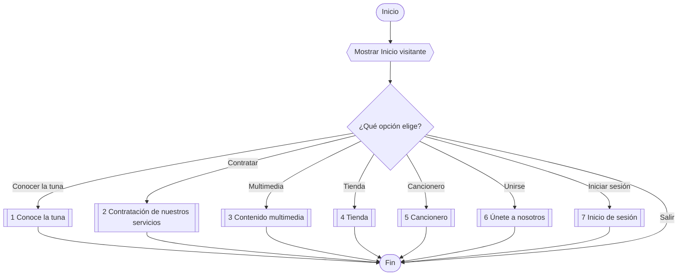

#### VIS · 1 Conoce la tuna

- **Perfil:** Visitante
- **Archivos:** wireframe `wireframes/visitante/Conoce.html` · imagen `wireframes_png/visitante/1_Conoce.png` · flujo `diagramas_tuna/visitante/1_conoce_la_tuna.mmd`
- **Se llega desde:** 0 Inicio visitante; 1.1 Historia; 1.2 Miembros; la cabecera y el pie (navegación común)

**Estructura del wireframe:**

- **Migas:** Inicio › Conoce la tuna
- **Título:** Conoce la tuna
- Texto: Nuestra historia y las personas que formamos la tuna
- Imagen/multimedia (marcador): «Imagen de cabecera»
- Tarjeta «1.1 Historia» — Cómo nació y cómo ha evolucionado la tuna → 1.1 Historia (con imagen «Imagen»)
- Tarjeta «1.2 Miembros» — Quiénes somos, instrumento y año de ingreso → 1.2 Miembros (con imagen «Imagen»)

**Flujo:**

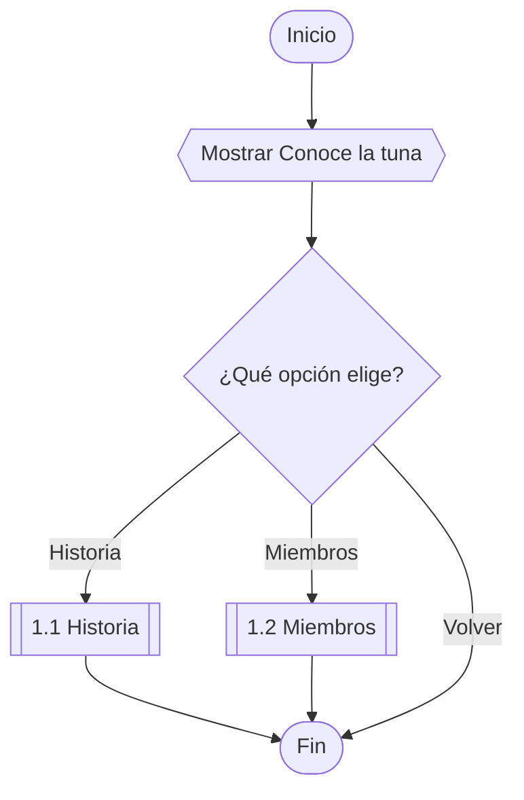

#### VIS · 1.1 Historia

- **Perfil:** Visitante
- **Archivos:** wireframe `wireframes/visitante/Historia.html` · imagen `wireframes_png/visitante/1.1_Historia.png` · flujo `diagramas_tuna/visitante/1.1_historia.mmd`
- **Se llega desde:** 1 Conoce la tuna; 1.2 Miembros

**Estructura del wireframe:**

- **Migas:** Inicio › Conoce la tuna › Historia
- **Título:** Historia
- Texto: Cómo nació la tuna y cómo hemos llegado hasta hoy
- Imagen/multimedia (marcador): «Imagen histórica»
- Texto: [Texto de la historia de la tuna: orígenes, fundadores y primeros años.]
- Texto: [Texto de la historia de la tuna: evolución, giras y actuaciones destacadas.]
- Texto: [Texto de la historia de la tuna: presente y proyectos futuros.]
- Texto destacado: [Año 1]
- Texto: [Hito de la historia]
  - (el bloque anterior se repite ×4 con datos distintos)
- Botón «Ver miembros» → 1.2 Miembros
- Botón «Volver» → 1 Conoce la tuna

**Flujo:**

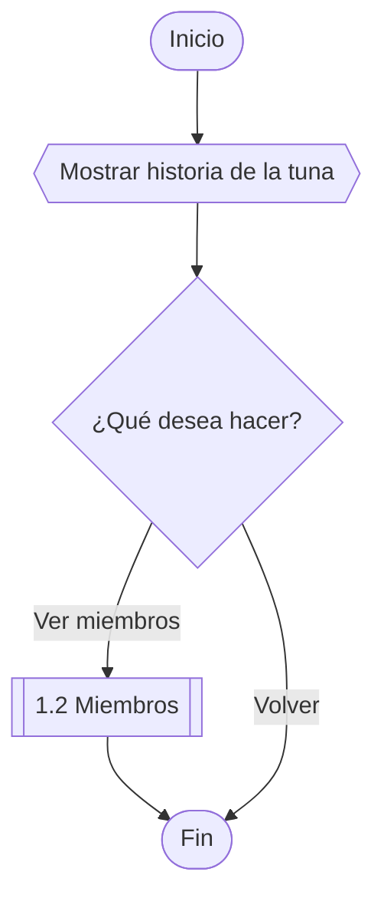

#### VIS · 1.2 Miembros

- **Perfil:** Visitante
- **Archivos:** wireframe `wireframes/visitante/Miembros.html` · imagen `wireframes_png/visitante/1.2_Miembros.png` · flujo `diagramas_tuna/visitante/1.2_miembros.mmd`
- **Se llega desde:** 1 Conoce la tuna; 1.1 Historia

**Estructura del wireframe:**

- **Migas:** Inicio › Conoce la tuna › Miembros
- **Título:** Miembros
- Texto: Pulsa un miembro para ver su ficha
- Imagen/multimedia (marcador): «Foto»
- Texto destacado: [Miembro 1]
- Texto: [Instrumento]
- Enlace «Ver ficha» (acción en la misma pantalla)
  - (el bloque anterior se repite ×6 con datos distintos)
- Bloque «Ficha del miembro»:
  - Imagen/multimedia (marcador): «Foto del miembro»
  - Texto destacado: [Nombre del miembro]
  - Texto: Instrumento: [instrumento] · En la tuna desde [año]
  - Texto: [Breve biografía del miembro.]
  - Botón «Volver a la lista» → 1.2 Miembros
- Botón «Ver historia» → 1.1 Historia

**Flujo:**

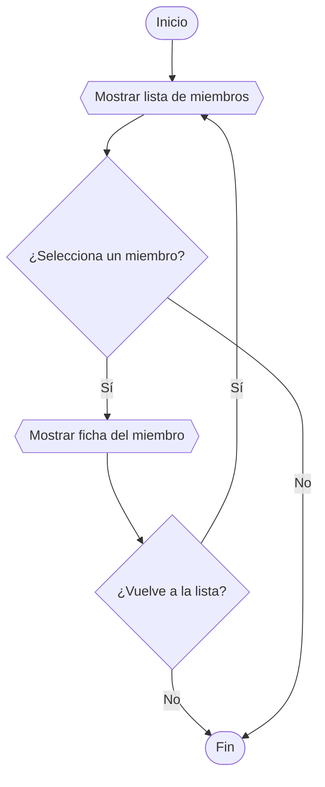

#### VIS · 2 Contratación de nuestros servicios

- **Perfil:** Visitante
- **Archivos:** wireframe `wireframes/visitante/Contratacion.html` · imagen `wireframes_png/visitante/2_Contratacion.png` · flujo `diagramas_tuna/visitante/2_contratacion_de_servicios.mmd`
- **Se llega desde:** 0 Inicio visitante; 2.1 Inicio de sesión para contratación; 2.1.1 Rellenar formulario de contratación; la cabecera y el pie (navegación común)

**Estructura del wireframe:**

- **Migas:** Inicio › Contratación
- **Título:** Contratación de nuestros servicios
- Texto: Elige el servicio que necesitas y envíanos tu solicitud
- Imagen/multimedia (marcador): «Imagen»
- Subtítulo: [Servicio 1]
- Texto: [Descripción del servicio]
- Texto destacado: [Desde X €]
  - (el bloque anterior se repite ×3 con datos distintos)
- Subtítulo: ¿Queréis contratarnos?
- Texto: Hace falta iniciar sesión o registrarse para enviar la solicitud.
- Botón «Contratar» → 2.1 Inicio de sesión para contratación

**Flujo:**

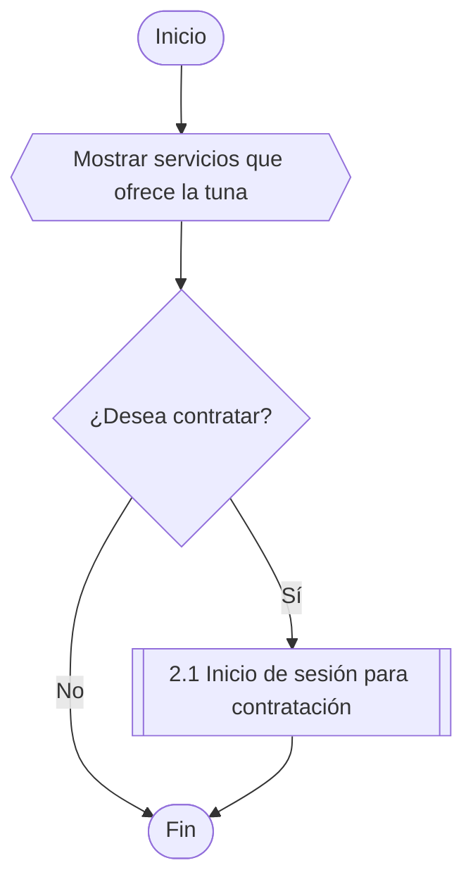

#### VIS · 2.1 Inicio de sesión para contratación

- **Perfil:** Visitante
- **Archivos:** wireframe `wireframes/visitante/AccesoContratacion.html` · imagen `wireframes_png/visitante/2.1_AccesoContratacion.png` · flujo `diagramas_tuna/visitante/2.1_inicio_sesion_contratacion.mmd`
- **Se llega desde:** 2 Contratación de nuestros servicios; 2.1.1 Rellenar formulario de contratación

**Estructura del wireframe:**

- **Migas:** Inicio › Contratación › Inicio de sesión para contratación
- **Título:** Inicia sesión para contratar
- Texto: Necesitamos tu cuenta de cliente para registrar la solicitud
- Bloque «¿Ya tienes cuenta?»:
  - Texto: Inicia sesión y volverás a la solicitud de contratación.
  - Botón «Iniciar sesión» → 7 Inicio de sesión
- Bloque «¿Eres nuevo?»:
  - Texto: Crea tu cuenta de cliente en un minuto.
  - Botón «Registrarse» → 7.2 Registrarse
- Bloque «Si ya has iniciado sesión»:
  - Texto: Continúa con el formulario de contratación.
  - Botón «Continuar con la contratación» → 2.1.1 Rellenar formulario de contratación
- **Estado de pantalla — Aviso:** Solo las cuentas de cliente pueden contratar. Se muestra si se ha entrado con una cuenta de administrador.

**Flujo:**

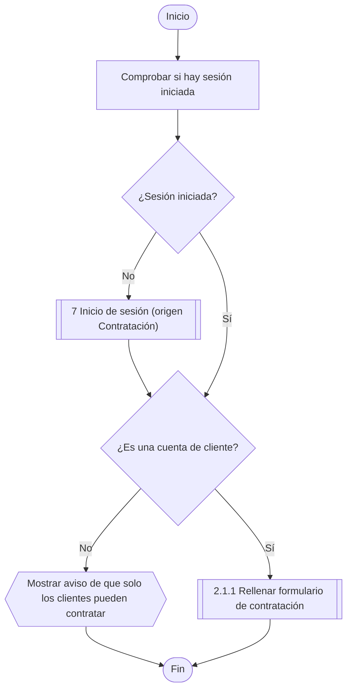

#### VIS · 2.1.1 Rellenar formulario de contratación

- **Perfil:** Visitante
- **Archivos:** wireframe `wireframes/visitante/FormularioContratacion.html` · imagen `wireframes_png/visitante/2.1.1_FormularioContratacion.png` · flujo `diagramas_tuna/visitante/2.1.1_formulario_contratacion.mmd`
- **Se llega desde:** 2.1 Inicio de sesión para contratación; 7 Inicio de sesión

**Estructura del wireframe:**

- **Migas:** Inicio › Contratación › Inicio de sesión para contratación › Formulario de contratación
- **Título:** Formulario de contratación
- Texto: Cuéntanos qué necesitas y nos pondremos en contacto
- Campo «Tipo de evento» (lista desplegable: [Serenata], [Boda], [Evento privado])
- Campo «Número aproximado de asistentes» (número)
- Campo «Fecha» (fecha)
- Campo «Hora» (hora)
- Campo «Lugar del evento» (texto)
- Campo «Observaciones» (texto largo)
- Casilla: Acepto las condiciones de contratación y la política de privacidad
- Botón «Enviar solicitud» (acción del formulario)
- Botón «Cancelar» → 2 Contratación de nuestros servicios
- **Estado de pantalla — Validación:** [Mensaje de error junto al campo no válido, p. ej. «Indica la fecha del evento»]
- **Estado de pantalla — Confirmación:** Solicitud enviada. Podrás seguir su estado en Mis contratos.

**Flujo:**

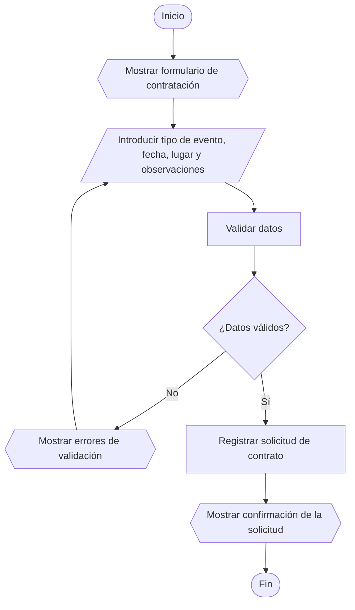

#### VIS · 3 Contenido multimedia

- **Perfil:** Visitante
- **Archivos:** wireframe `wireframes/visitante/Multimedia.html` · imagen `wireframes_png/visitante/3_Multimedia.png` · flujo `diagramas_tuna/visitante/3_contenido_multimedia.mmd`
- **Se llega desde:** 0 Inicio visitante; 3.1 Nuestros mejores momentos; 3.1.1 Vídeos; 3.1.2 Fotos; 3.2 Certámenes; la cabecera y el pie (navegación común)

**Estructura del wireframe:**

- **Migas:** Inicio › Multimedia
- **Título:** Contenido multimedia
- Texto: Vídeos, fotos y certámenes en los que hemos participado
- Imagen/multimedia (marcador): «Imagen de cabecera»
- Tarjeta «3.1 Nuestros mejores momentos» — Vídeos y fotos → 3.1 Nuestros mejores momentos (con imagen «Imagen»)
- Tarjeta «3.2 Certámenes» — Certámenes en los que hemos participado → 3.2 Certámenes (con imagen «Imagen»)

**Flujo:**

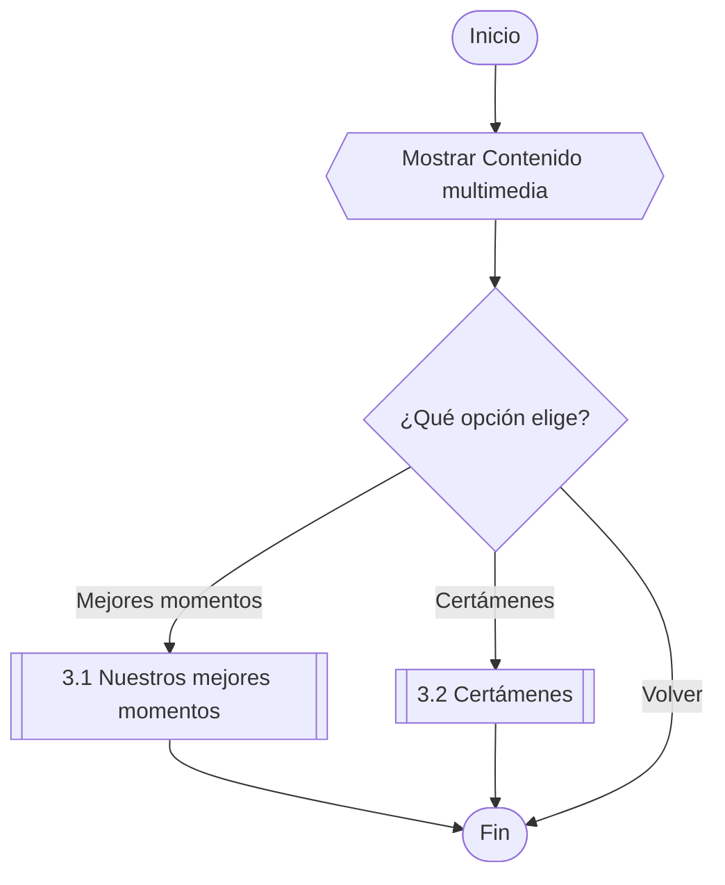

#### VIS · 3.1 Nuestros mejores momentos

- **Perfil:** Visitante
- **Archivos:** wireframe `wireframes/visitante/MejoresMomentos.html` · imagen `wireframes_png/visitante/3.1_MejoresMomentos.png` · flujo `diagramas_tuna/visitante/3.1_mejores_momentos.mmd`
- **Se llega desde:** 3 Contenido multimedia; 3.1.1 Vídeos; 3.1.2 Fotos

**Estructura del wireframe:**

- **Migas:** Inicio › Multimedia › Nuestros mejores momentos
- **Título:** Nuestros mejores momentos
- Texto: Elige el formato
- Tarjeta «3.1.1 Vídeos» — Galería de vídeos → 3.1.1 Vídeos (con imagen «Miniatura de vídeo»)
- Tarjeta «3.1.2 Fotos» — Galería de fotos → 3.1.2 Fotos (con imagen «Foto»)

**Flujo:**

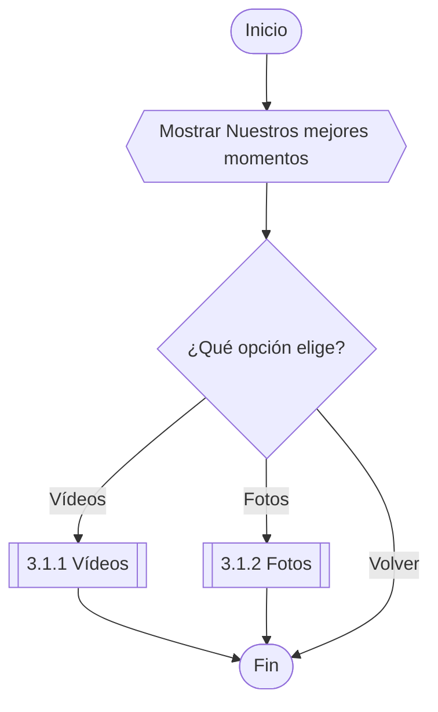

#### VIS · 3.1.1 Vídeos

- **Perfil:** Visitante
- **Archivos:** wireframe `wireframes/visitante/Videos.html` · imagen `wireframes_png/visitante/3.1.1_Videos.png` · flujo `diagramas_tuna/visitante/3.1.1_videos.mmd`
- **Se llega desde:** 3.1 Nuestros mejores momentos; 3.1.2 Fotos

**Estructura del wireframe:**

- **Migas:** Inicio › Multimedia › Nuestros mejores momentos › Vídeos
- **Título:** Vídeos
- Texto: Selecciona un vídeo para reproducirlo
- Imagen/multimedia (marcador): «▶ Reproductor de vídeo»
- Texto destacado: [Título del vídeo seleccionado]
- Texto: [Descripción breve]
- Imagen/multimedia (marcador): «▶»
- Texto destacado: [Vídeo 1]
- Texto: [Duración] · [Fecha]
  - (el bloque anterior se repite ×4 con datos distintos)
- Botón «Volver a mejores momentos» → 3.1 Nuestros mejores momentos
- Botón «Ver fotos» → 3.1.2 Fotos

**Flujo:**

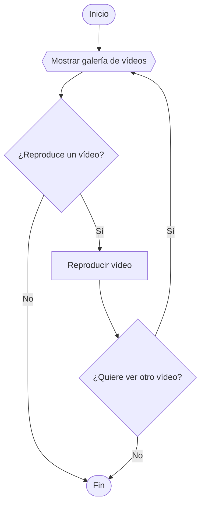

#### VIS · 3.1.2 Fotos

- **Perfil:** Visitante
- **Archivos:** wireframe `wireframes/visitante/Fotos.html` · imagen `wireframes_png/visitante/3.1.2_Fotos.png` · flujo `diagramas_tuna/visitante/3.1.2_fotos.mmd`
- **Se llega desde:** 3.1 Nuestros mejores momentos; 3.1.1 Vídeos

**Estructura del wireframe:**

- **Migas:** Inicio › Multimedia › Nuestros mejores momentos › Fotos
- **Título:** Fotos
- Texto: Pulsa una foto para ampliarla
- Imagen/multimedia (marcador): «Foto 1»
- Imagen/multimedia (marcador): «Foto 2»
- Imagen/multimedia (marcador): «Foto 3»
- Imagen/multimedia (marcador): «Foto 4»
- Imagen/multimedia (marcador): «Foto 5»
- Imagen/multimedia (marcador): «Foto 6»
- Imagen/multimedia (marcador): «Foto 7»
- Imagen/multimedia (marcador): «Foto 8»
- Imagen/multimedia (marcador): «Foto 9»
- Bloque «Foto ampliada»:
  - Imagen/multimedia (marcador): «Foto seleccionada»
  - Texto: [Pie de foto]
  - Enlace «‹ Anterior» (acción en la misma pantalla)
  - Enlace «Siguiente ›» (acción en la misma pantalla)
  - Enlace «Cerrar» (acción en la misma pantalla)
- Botón «Volver a mejores momentos» → 3.1 Nuestros mejores momentos
- Botón «Ver vídeos» → 3.1.1 Vídeos

**Flujo:**

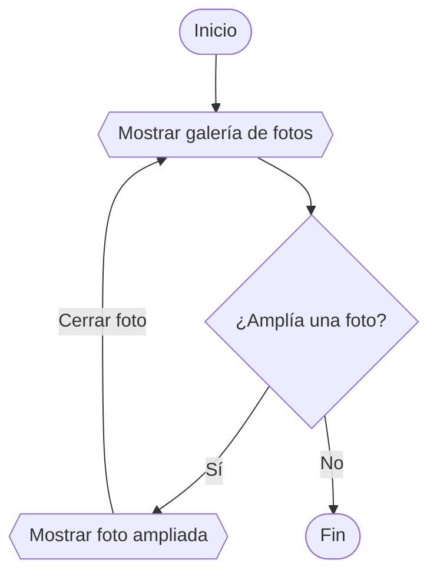

#### VIS · 3.2 Certámenes

- **Perfil:** Visitante
- **Archivos:** wireframe `wireframes/visitante/Certamenes.html` · imagen `wireframes_png/visitante/3.2_Certamenes.png` · flujo `diagramas_tuna/visitante/3.2_certamenes.mmd`
- **Se llega desde:** 3 Contenido multimedia

**Estructura del wireframe:**

- **Migas:** Inicio › Multimedia › Certámenes
- **Título:** Certámenes
- Texto: Certámenes en los que hemos participado
- Imagen/multimedia (marcador): «Cartel»
- Texto destacado: [Certamen 1]
- Texto: [Año] · [Lugar]
- Enlace «Ver detalle» (acción en la misma pantalla)
  - (el bloque anterior se repite ×4 con datos distintos)
- Bloque «Detalle del certamen»:
  - Imagen/multimedia (marcador): «Cartel del certamen»
  - Texto destacado: [Nombre del certamen]
  - Texto: [Fecha] · [Lugar]
  - Texto: Premios obtenidos: [premios]
  - Imagen/multimedia (marcador): «Foto»
  - Imagen/multimedia (marcador): «Foto»
  - Imagen/multimedia (marcador): «Foto»
  - Botón «Volver a la lista» → 3.2 Certámenes
- **Estado de pantalla — Vacío:** Si todavía no hay certámenes: «Aún no hay certámenes publicados».

**Flujo:**

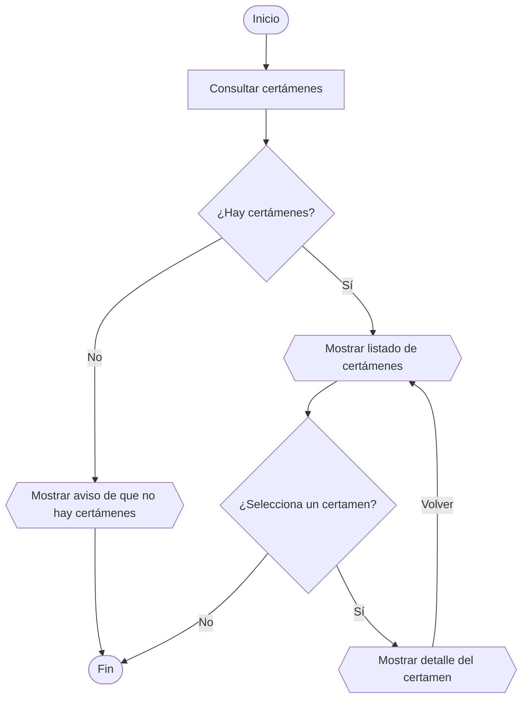

#### VIS · 4 Tienda

- **Perfil:** Visitante
- **Archivos:** wireframe `wireframes/visitante/Tienda.html` · imagen `wireframes_png/visitante/4_Tienda.png` · flujo `diagramas_tuna/visitante/4_tienda.mmd`
- **Se llega desde:** 0 Inicio visitante; 4.1 Catálogo; 4.2 Cesta; 4.2.1 Iniciar sesión o registrarse para realizar pedido; 4.2.1.1 Dirección de envío; la cabecera y el pie (navegación común)

**Estructura del wireframe:**

- **Migas:** Inicio › Tienda
- **Título:** Tienda
- Texto: Productos oficiales de la tuna
- Imagen/multimedia (marcador): «Imagen de cabecera»
- Tarjeta «4.1 Catálogo» — Todos los productos disponibles → 4.1 Catálogo (con imagen «Imagen»)
- Tarjeta «4.2 Cesta» — Revisa y modifica los productos que has añadido → 4.2 Cesta (con imagen «Imagen»)

**Flujo:**

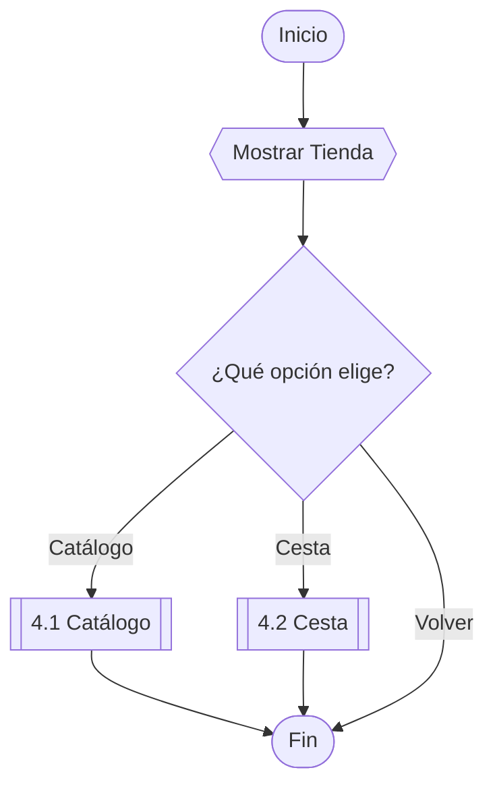

#### VIS · 4.1 Catálogo

- **Perfil:** Visitante
- **Archivos:** wireframe `wireframes/visitante/Catalogo.html` · imagen `wireframes_png/visitante/4.1_Catalogo.png` · flujo `diagramas_tuna/visitante/4.1_catalogo.mmd`
- **Se llega desde:** 4 Tienda; 4.2 Cesta

**Estructura del wireframe:**

- **Migas:** Inicio › Tienda › Catálogo
- **Título:** Catálogo
- Texto: Filtra y elige tus productos
- Campo «Categoría» (lista desplegable: Todas las categorías)
- Campo «Precio» (lista desplegable: Cualquier precio)
- Botón «Aplicar filtros» (acción del formulario)
- Imagen/multimedia (marcador): «Foto producto»
- Texto destacado: [Producto 1]
- Texto: [Precio] €
- Enlace «Ver detalle» (acción en la misma pantalla)
  - (el bloque anterior se repite ×6 con datos distintos)
- Bloque «Detalle del producto»:
  - Imagen/multimedia (marcador): «Foto del producto»
  - Texto destacado: [Nombre del producto]
  - Texto: [Descripción del producto] · [Precio] €
  - Campo «Talla» (lista desplegable: [Talla])
  - Campo «Cantidad» (número)
  - Botón «Añadir a la cesta» (acción del formulario)
  - Enlace «Ir a la cesta» → 4.2 Cesta
  - Enlace «Seguir comprando» (acción en la misma pantalla)

**Flujo:**

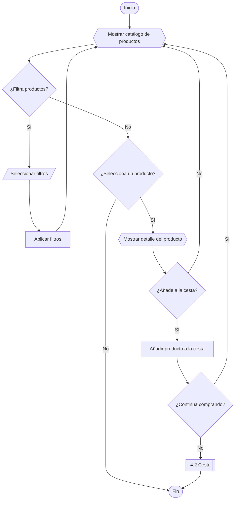

#### VIS · 4.2 Cesta

- **Perfil:** Visitante
- **Archivos:** wireframe `wireframes/visitante/Cesta.html` · imagen `wireframes_png/visitante/4.2_Cesta.png` · flujo `diagramas_tuna/visitante/4.2_cesta.mmd`
- **Se llega desde:** 4 Tienda; 4.1 Catálogo; 4.2.1 Iniciar sesión o registrarse para realizar pedido; 4.2.1.1 Dirección de envío; la cabecera y el pie (navegación común)

**Estructura del wireframe:**

- **Migas:** Inicio › Tienda › Cesta
- **Título:** Cesta
- Texto: Revisa tu pedido antes de continuar
- Tabla — columnas: Producto | Precio | Cantidad | Subtotal | (acciones) (2 filas de ejemplo)
  - acción por fila: «Eliminar» (acción en la fila)
- Bloque «Resumen»:
  - Texto: Subtotal
  - Texto: [X] €
  - Texto: Envío
  - Texto: [X] €
  - Texto destacado: Total
  - Texto destacado: [X] €
  - Botón «Realizar pedido» → 4.2.1 Iniciar sesión o registrarse para realizar pedido
  - Botón «Seguir comprando» → 4.1 Catálogo
- **Estado de pantalla — Vacío:** Cesta vacía: «Tu cesta está vacía» + enlace a Catálogo.

**Flujo:**

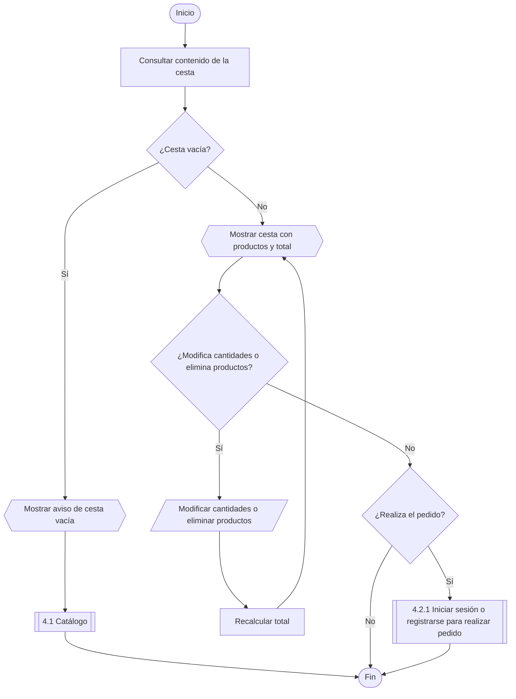

#### VIS · 4.2.1 Iniciar sesión o registrarse para realizar pedido

- **Perfil:** Visitante
- **Archivos:** wireframe `wireframes/visitante/AccesoPedido.html` · imagen `wireframes_png/visitante/4.2.1_AccesoPedido.png` · flujo `diagramas_tuna/visitante/4.2.1_iniciar_sesion_para_pedido.mmd`
- **Se llega desde:** 4.2 Cesta; 4.2.1.1 Dirección de envío

**Estructura del wireframe:**

- **Migas:** Inicio › Tienda › Cesta › Iniciar sesión o registrarse
- **Título:** Inicia sesión o regístrate para realizar el pedido
- Texto: Necesitamos tu cuenta para gestionar el envío
- Bloque «¿Ya tienes cuenta?»:
  - Texto: Inicia sesión y continuarás con la dirección de envío.
  - Botón «Iniciar sesión» → 7 Inicio de sesión
- Bloque «¿Eres nuevo?»:
  - Texto: Crea tu cuenta para poder realizar el pedido.
  - Botón «Registrarse» → 7.2 Registrarse
- Bloque «Si ya has iniciado sesión»:
  - Texto: Continúa con el pedido.
  - Botón «Continuar con el pedido» → 4.2.1.1 Dirección de envío
  - Botón «Volver a la cesta» → 4.2 Cesta

**Flujo:**

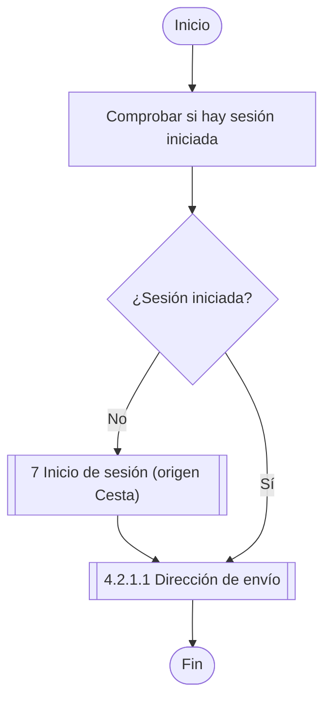

#### VIS · 4.2.1.1 Dirección de envío

- **Perfil:** Visitante
- **Archivos:** wireframe `wireframes/visitante/DireccionEnvio.html` · imagen `wireframes_png/visitante/4.2.1.1_DireccionEnvio.png` · flujo `diagramas_tuna/visitante/4.2.1.1_direccion_de_envio.mmd`
- **Se llega desde:** 4.2.1 Iniciar sesión o registrarse para realizar pedido; 7 Inicio de sesión

**Estructura del wireframe:**

- **Migas:** Inicio › Tienda › Cesta › Iniciar sesión o registrarse › Dirección de envío
- **Título:** Dirección de envío
- Texto: Indica dónde quieres recibir tu pedido
- Bloque «Dirección de envío»:
  - Campo «Nombre y apellidos» (texto)
  - Campo «Dirección» (texto)
  - Campo «Ciudad» (texto)
  - Campo «Código postal» (texto)
  - Campo «Provincia» (texto)
  - Campo «Teléfono» (teléfono)
  - Botón «Confirmar pedido» (acción del formulario)
  - Botón «Volver a la cesta» → 4.2 Cesta
- Bloque «Resumen del pedido»:
  - Texto: [Producto 1] × 1 · [X] €
  - Texto: [Producto 2] × 1 · [X] €
  - Texto destacado: Total [X] €
- **Estado de pantalla — Validación:** [Mensaje de error junto al campo no válido]
- **Estado de pantalla — Confirmación:** Pedido registrado. Puedes consultarlo en Mis pedidos.

**Flujo:**

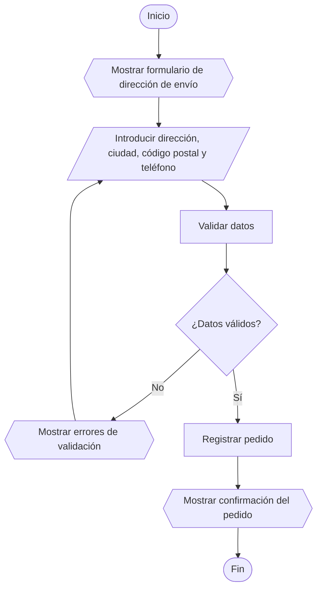

#### VIS · 5 Cancionero

- **Perfil:** Visitante
- **Archivos:** wireframe `wireframes/visitante/Cancionero.html` · imagen `wireframes_png/visitante/5_Cancionero.png` · flujo `diagramas_tuna/visitante/5_cancionero.mmd`
- **Se llega desde:** 0 Inicio visitante; 5.1 Nuestro repertorio de canciones; 5.2 Escúchanos en Spotify; la cabecera y el pie (navegación común)

**Estructura del wireframe:**

- **Migas:** Inicio › Cancionero
- **Título:** Cancionero
- Texto: Nuestro repertorio y nuestra música
- Imagen/multimedia (marcador): «Imagen de cabecera»
- Tarjeta «5.1 Nuestro repertorio de canciones» — Consulta y busca las canciones que interpretamos → 5.1 Nuestro repertorio de canciones (con imagen «Imagen»)
- Tarjeta «5.2 Escúchanos en Spotify» — Nuestro perfil de Spotify → 5.2 Escúchanos en Spotify (con imagen «Imagen»)

**Flujo:**

```mermaid
flowchart TD
    INI(["Inicio"])
    P{{"Mostrar Cancionero"}}
    D{"¿Qué opción elige?"}
    FIN(["Fin"])
    S1[["5.1 Nuestro repertorio de canciones"]]
    S2[["5.2 Escúchanos en Spotify"]]

    INI --> P
    P --> D
    D -- "Repertorio" --> S1
    S1 --> FIN
    D -- "Spotify" --> S2
    S2 --> FIN
    D -- "Volver" --> FIN
```

#### VIS · 5.1 Nuestro repertorio de canciones

- **Perfil:** Visitante
- **Archivos:** wireframe `wireframes/visitante/Repertorio.html` · imagen `wireframes_png/visitante/5.1_Repertorio.png` · flujo `diagramas_tuna/visitante/5.1_repertorio.mmd`
- **Se llega desde:** 5 Cancionero

**Estructura del wireframe:**

- **Migas:** Inicio › Cancionero › Nuestro repertorio de canciones
- **Título:** Nuestro repertorio de canciones
- Texto: Busca por título o palabra clave
- Campo de búsqueda/entrada (placeholder «Buscar canción...»)
- Filtro (lista desplegable: Todos los géneros)
- Botón «Buscar» (acción del formulario)
- Tabla — columnas: Canción | Autor | Género (8 filas de ejemplo)
- Texto: Mostrando 1–6 de [N] · ‹ 1 2 3 ›
- **Estado de pantalla — Sin resultados:** «No hay canciones que coincidan con tu búsqueda» · vuelve al listado completo.

**Flujo:**

```mermaid
flowchart TD
    INI(["Inicio"])
    P{{"Mostrar repertorio de canciones"}}
    D1{"¿Busca una canción?"}
    I[/"Introducir título o palabra clave"/]
    F["Filtrar repertorio"]
    D2{"¿Hay resultados?"}
    ERR{{"Mostrar aviso de que no hay resultados"}}
    R{{"Mostrar canciones encontradas"}}
    FIN(["Fin"])

    INI --> P
    P --> D1
    D1 -- "Sí" --> I
    I --> F
    F --> D2
    D2 -- "No" --> ERR
    ERR --> P
    D2 -- "Sí" --> R
    R --> FIN
    D1 -- "No" --> FIN
```

#### VIS · 5.2 Escúchanos en Spotify

- **Perfil:** Visitante
- **Archivos:** wireframe `wireframes/visitante/Spotify.html` · imagen `wireframes_png/visitante/5.2_Spotify.png` · flujo `diagramas_tuna/visitante/5.2_escuchanos_en_spotify.mmd`
- **Se llega desde:** 5 Cancionero

**Estructura del wireframe:**

- **Migas:** Inicio › Cancionero › Escúchanos en Spotify
- **Título:** Escúchanos en Spotify
- Texto: Nuestro perfil de artista
- Imagen/multimedia (marcador): «Portada del perfil»
- Texto destacado: [Nombre de la tuna]
- Texto: [Oyentes mensuales]
- Imagen/multimedia (marcador): «Reproductor de Spotify (incrustado)»
- Botón «Abrir en Spotify» → enlace externo (https://open.spotify.com/)
- Botón «Volver al cancionero» → 5 Cancionero

**Flujo:**

```mermaid
flowchart TD
    INI(["Inicio"])
    P{{"Mostrar perfil de la tuna en Spotify"}}
    D{"¿Abre Spotify?"}
    R["Redirigir a Spotify (enlace externo)"]
    FIN(["Fin"])

    INI --> P
    P --> D
    D -- "Sí" --> R
    R --> FIN
    D -- "No" --> FIN
```

#### VIS · 6 Únete a nosotros

- **Perfil:** Visitante
- **Archivos:** wireframe `wireframes/visitante/Unete.html` · imagen `wireframes_png/visitante/6_Unete.png` · flujo `diagramas_tuna/visitante/6_unete_a_nosotros.mmd`
- **Se llega desde:** 0 Inicio visitante; 6.1 Formulario para unirse; 6.2 Local de ensayo; la cabecera y el pie (navegación común)

**Estructura del wireframe:**

- **Migas:** Inicio › Únete a nosotros
- **Título:** Únete a nosotros
- Texto: ¿Tocas un instrumento o cantas? Te esperamos
- Imagen/multimedia (marcador): «Imagen de cabecera»
- Tarjeta «6.1 Formulario para unirse» — Envíanos tu solicitud → 6.1 Formulario para unirse (con imagen «Imagen»)
- Tarjeta «6.2 Local de ensayo» — Dónde y cuándo ensayamos → 6.2 Local de ensayo (con imagen «Imagen»)

**Flujo:**

```mermaid
flowchart TD
    INI(["Inicio"])
    P{{"Mostrar Únete a nosotros"}}
    D{"¿Qué opción elige?"}
    FIN(["Fin"])
    S1[["6.1 Formulario para unirse"]]
    S2[["6.2 Local de ensayo"]]

    INI --> P
    P --> D
    D -- "Formulario" --> S1
    S1 --> FIN
    D -- "Local" --> S2
    S2 --> FIN
    D -- "Volver" --> FIN
```

#### VIS · 6.1 Formulario para unirse

- **Perfil:** Visitante
- **Archivos:** wireframe `wireframes/visitante/Formulario.html` · imagen `wireframes_png/visitante/6.1_Formulario.png` · flujo `diagramas_tuna/visitante/6.1_formulario_para_unirse.mmd`
- **Se llega desde:** 6 Únete a nosotros; 6.2 Local de ensayo; la cabecera y el pie (navegación común)

**Estructura del wireframe:**

- **Migas:** Inicio › Únete a nosotros › Formulario para unirse
- **Título:** Formulario para unirse
- Texto: Cuéntanos quién eres y qué tocas
- Campo «Nombre y apellidos» (texto)
- Campo «Correo electrónico» (correo)
- Campo «Teléfono» (teléfono)
- Campo «Instrumento» (lista desplegable: [Instrumento])
- Campo «Experiencia musical» (texto largo)
- Casilla: Acepto la política de privacidad
- Botón «Enviar solicitud» (acción del formulario)
- Botón «Cancelar» → 6 Únete a nosotros
- **Estado de pantalla — Validación:** [Mensaje de error junto al campo no válido]
- **Estado de pantalla — Confirmación:** Solicitud enviada. Nos pondremos en contacto contigo · enlace a la información del local de ensayo.

**Flujo:**

```mermaid
flowchart TD
    INI(["Inicio"])
    P{{"Mostrar formulario de solicitud para unirse"}}
    F[/"Introducir nombre, contacto, instrumento y experiencia musical"/]
    V["Validar datos"]
    D{"¿Datos válidos?"}
    ERR{{"Mostrar errores de validación"}}
    G["Guardar solicitud de ingreso"]
    C{{"Mostrar confirmación"}}
    FIN(["Fin"])

    INI --> P
    P --> F
    F --> V
    V --> D
    D -- "No" --> ERR
    ERR --> F
    D -- "Sí" --> G
    G --> C
    C --> FIN
```

#### VIS · 6.2 Local de ensayo

- **Perfil:** Visitante
- **Archivos:** wireframe `wireframes/visitante/LocalEnsayo.html` · imagen `wireframes_png/visitante/6.2_LocalEnsayo.png` · flujo `diagramas_tuna/visitante/6.2_local_de_ensayo.mmd`
- **Se llega desde:** 6 Únete a nosotros

**Estructura del wireframe:**

- **Migas:** Inicio › Únete a nosotros › Local de ensayo
- **Título:** Local de ensayo
- Texto: Dónde y cuándo ensayamos
- Imagen/multimedia (marcador): «Mapa del local»
- Bloque «Dirección»:
  - Texto: [Calle, número] · [Ciudad]
- Bloque «Horarios»:
  - Tabla — columnas: Día | Horario (2 filas de ejemplo)
- Botón «Quiero unirme» → 6.1 Formulario para unirse
- Botón «Volver» → 6 Únete a nosotros

**Flujo:**

```mermaid
flowchart TD
    INI(["Inicio"])
    P{{"Mostrar dirección, mapa y horarios del local de ensayo"}}
    D{"¿Quiere unirse a la tuna?"}
    F[["6.1 Formulario para unirse"]]
    FIN(["Fin"])

    INI --> P
    P --> D
    D -- "Sí" --> F
    F --> FIN
    D -- "No" --> FIN
```

#### VIS · 7 Inicio de sesión

- **Perfil:** Visitante
- **Archivos:** wireframe `wireframes/visitante/Acceso.html` · imagen `wireframes_png/visitante/7_Acceso.png` · flujo `diagramas_tuna/visitante/7_inicio_de_sesion.mmd`
- **Se llega desde:** 2.1 Inicio de sesión para contratación; 4.2.1 Iniciar sesión o registrarse para realizar pedido; 7.1 Recuperar contraseña; 7.2 Registrarse; la cabecera y el pie (navegación común)

**Estructura del wireframe:**

- **Migas:** Inicio › Inicio de sesión
- **Título:** Inicio de sesión
- Texto: Accede a tu cuenta
- Bloque «Iniciar sesión»:
  - Campo «Correo electrónico» (correo)
  - Campo «Contraseña» (contraseña)
  - Botón «Iniciar sesión» (acción del formulario)
  - Enlace «¿Has olvidado la contraseña?» → 7.1 Recuperar contraseña
  - Enlace «¿No tienes cuenta? Registrarse» → 7.2 Registrarse
- Bloque «Redirección tras iniciar sesión»:
  - Texto: Según de dónde vengas:
  - Lista: Desde Contratación → formulario de contratación; Desde la Cesta → dirección de envío; Acceso directo, cuenta de cliente → Inicio de cliente; Acceso directo, administrador → Panel de administración
- **Estado de pantalla — Error:** «Correo o contraseña incorrectos» · se muestra de nuevo el formulario.

**Flujo:**

```mermaid
flowchart TD
    INI(["Inicio"])
    P{{"Mostrar formulario de inicio de sesión"}}
    D1{"¿Tiene cuenta?"}
    REG[["7.2 Registrarse"]]
    D2{"¿Recuerda la contraseña?"}
    REC[["7.1 Recuperar contraseña"]]
    T[/"Introducir correo y contraseña"/]
    V["Validar credenciales"]
    D3{"¿Credenciales correctas?"}
    ERR{{"Mostrar mensaje de error"}}
    S["Crear sesión del usuario"]
    D4{"¿Desde dónde accedió?"}
    CON[["2.1.1 Rellenar formulario de contratación"]]
    CES[["4.2.1.1 Dirección de envío"]]
    D5{"¿Rol de la cuenta?"}
    CLI{{"Mostrar Inicio de cliente"}}
    ADM{{"Mostrar Panel de administración"}}
    FIN(["Fin"])

    INI --> P
    P --> D1
    D1 -- No --> REG
    REG --> P
    D1 -- Sí --> D2
    D2 -- No --> REC
    REC --> P
    D2 -- Sí --> T
    T --> V
    V --> D3
    D3 -- No --> ERR
    ERR --> P
    D3 -- Sí --> S
    S --> D4
    D4 -- Contratación --> CON
    D4 -- Cesta --> CES
    D4 -- Directo --> D5
    D5 -- Cliente --> CLI
    D5 -- Administrador --> ADM
    CON --> FIN
    CES --> FIN
    CLI --> FIN
    ADM --> FIN
```

#### VIS · 7.1 Recuperar contraseña

- **Perfil:** Visitante
- **Archivos:** wireframe `wireframes/visitante/RecuperarContrasena.html` · imagen `wireframes_png/visitante/7.1_RecuperarContrasena.png` · flujo `diagramas_tuna/visitante/7.1_recuperar_contrasena.mmd`
- **Se llega desde:** 7 Inicio de sesión

**Estructura del wireframe:**

- **Migas:** Inicio › Inicio de sesión › Recuperar contraseña
- **Título:** Recuperar contraseña
- Texto: Te enviaremos un enlace para crear una nueva
- Bloque «1. Solicitar enlace»:
  - Campo «Correo electrónico» (correo)
  - Botón «Enviar enlace de recuperación» (acción del formulario)
  - **Estado de pantalla — Error:** «El correo no está registrado»
  - **Estado de pantalla — Aviso:** «Te hemos enviado un correo con el enlace»
- Bloque «2. Nueva contraseña (desde el enlace del correo)»:
  - Campo «Nueva contraseña» (contraseña)
  - Campo «Repetir contraseña» (contraseña)
  - Botón «Guardar contraseña» (acción del formulario)
  - **Estado de pantalla — Error:** «La contraseña no cumple los requisitos»
  - **Estado de pantalla — Confirmación:** Contraseña actualizada · Iniciar sesión
- Botón «Volver al inicio de sesión» → 7 Inicio de sesión

**Flujo:**

```mermaid
flowchart TD
    INI(["Inicio"])
    P{{"Mostrar formulario de recuperación"}}
    I[/"Introducir correo electrónico"/]
    D1{"¿Correo registrado?"}
    ERR1{{"Mostrar mensaje de correo no registrado"}}
    E["Enviar enlace de recuperación por correo"]
    M{{"Mostrar aviso de correo enviado"}}
    N[/"Introducir nueva contraseña desde el enlace"/]
    V["Validar nueva contraseña"]
    D2{"¿Contraseña válida y confirmada?"}
    ERR2{{"Mostrar requisitos de contraseña"}}
    G["Actualizar contraseña"]
    C{{"Mostrar confirmación de cambio"}}
    LOG[["7 Inicio de sesión"]]
    FIN(["Fin"])

    INI --> P
    P --> I
    I --> D1
    D1 -- "No" --> ERR1
    ERR1 --> P
    D1 -- "Sí" --> E
    E --> M
    M --> N
    N --> V
    V --> D2
    D2 -- "No" --> ERR2
    ERR2 --> N
    D2 -- "Sí" --> G
    G --> C
    C --> LOG
    LOG --> FIN
```

#### VIS · 7.2 Registrarse

- **Perfil:** Visitante
- **Archivos:** wireframe `wireframes/visitante/Registro.html` · imagen `wireframes_png/visitante/7.2_Registro.png` · flujo `diagramas_tuna/visitante/7.2_registrarse.mmd`
- **Se llega desde:** 2.1 Inicio de sesión para contratación; 4.2.1 Iniciar sesión o registrarse para realizar pedido; 7 Inicio de sesión

**Estructura del wireframe:**

- **Migas:** Inicio › Inicio de sesión › Registrarse
- **Título:** Registrarse
- Texto: Crea tu cuenta de cliente
- Campo «Nombre» (texto)
- Campo «Apellidos» (texto)
- Campo «Correo electrónico» (correo)
- Campo «Teléfono» (teléfono)
- Campo «Contraseña» (contraseña)
- Campo «Repetir contraseña» (contraseña)
- Casilla: Acepto los términos y la política de privacidad
- Botón «Crear cuenta» (acción del formulario)
- Enlace «¿Ya tienes cuenta? Iniciar sesión» → 7 Inicio de sesión
- **Estado de pantalla — Validación:** [Mensaje de error junto al campo no válido]
- **Estado de pantalla — Error:** Correo ya registrado: «Ya existe una cuenta con este correo» · Iniciar sesión
- **Estado de pantalla — Confirmación:** Cuenta creada · Iniciar sesión

**Flujo:**

```mermaid
flowchart TD
    INI(["Inicio"])
    P{{"Mostrar formulario de registro"}}
    F[/"Introducir nombre, correo y contraseña"/]
    V["Validar datos"]
    D1{"¿Datos válidos?"}
    ERR1{{"Mostrar errores de validación"}}
    D2{"¿Correo ya registrado?"}
    ERR2{{"Mostrar aviso de cuenta existente"}}
    G["Crear cuenta de cliente"]
    C{{"Mostrar confirmación de registro"}}
    LOG[["7 Inicio de sesión"]]
    FIN(["Fin"])

    INI --> P
    P --> F
    F --> V
    V --> D1
    D1 -- "No" --> ERR1
    ERR1 --> F
    D1 -- "Sí" --> D2
    D2 -- "Sí" --> ERR2
    ERR2 --> P
    D2 -- "No" --> G
    G --> C
    C --> LOG
    LOG --> FIN
```

### Cliente (10 pantallas)

#### CLI · 0 Inicio de cliente

- **Perfil:** Cliente
- **Archivos:** wireframe `wireframes/cliente/index.html` · imagen `wireframes_png/cliente/0_index.png` · flujo `diagramas_tuna/cliente/0_inicio_de_cliente.mmd`
- **Se llega desde:** Visitante: 7 Inicio de sesión; 1 Ver historial de contratos; 1.1 Ver contrato en detalle; 2 Ver historial de pedidos; 2.1 Ver pedido en detalle; 2.1.1 Editar datos del pedido; 2.1.2 Tramitar devolución; 3 Gestionar cuenta; 3.1 Modificar información personal; 3.2 Cambiar contraseña; la cabecera y el pie (navegación común)

**Estructura del wireframe:**

- **Título:** Hola, [Nombre del cliente]
- Texto: Tu área de cliente
- Tarjeta «1 Ver historial de contratos» — Tus solicitudes de contratación → 1 Ver historial de contratos (con imagen «Imagen»)
- Tarjeta «2 Ver historial de pedidos» — Tus compras en la tienda → 2 Ver historial de pedidos (con imagen «Imagen»)
- Tarjeta «3 Gestionar cuenta» — Tus datos y tu contraseña → 3 Gestionar cuenta (con imagen «Imagen»)
- Bloque «Último contrato»:
  - Tabla — columnas: Nº | Evento | Estado | (acciones) (1 filas de ejemplo)
    - acción por fila: «Ver» → 1.1 Ver contrato en detalle
- Bloque «Último pedido»:
  - Tabla — columnas: Nº | Total | Estado | (acciones) (1 filas de ejemplo)
    - acción por fila: «Ver» → 2.1 Ver pedido en detalle

**Flujo:**

```mermaid
flowchart TD
    INI(["Inicio"])
    P{{"Mostrar Inicio de cliente"}}
    D{"¿Qué opción elige?"}
    FIN(["Fin"])
    S1[["1 Ver historial de contratos"]]
    S2[["2 Ver historial de pedidos"]]
    S3[["3 Gestionar cuenta"]]

    INI --> P
    P --> D
    D -- "Contratos" --> S1
    S1 --> FIN
    D -- "Pedidos" --> S2
    S2 --> FIN
    D -- "Cuenta" --> S3
    S3 --> FIN
    D -- "Cerrar sesión" --> FIN
```

#### CLI · 1 Ver historial de contratos

- **Perfil:** Cliente
- **Archivos:** wireframe `wireframes/cliente/Contratos.html` · imagen `wireframes_png/cliente/1_Contratos.png` · flujo `diagramas_tuna/cliente/1_ver_historial_de_contratos.mmd`
- **Se llega desde:** Visitante: 2.1.1 Rellenar formulario de contratación; 0 Inicio de cliente; 1.1 Ver contrato en detalle; la cabecera y el pie (navegación común)

**Estructura del wireframe:**

- **Migas:** Inicio › Historial de contratos
- **Título:** Historial de contratos
- Texto: Tus solicitudes de contratación
- Tabla — columnas: Nº | Evento | Fecha | Estado | (acciones) (6 filas de ejemplo)
  - acción por fila: «Ver contrato en detalle» → 1.1 Ver contrato en detalle
- Texto: Mostrando 1–6 de [N] · ‹ 1 2 3 ›
- **Estado de pantalla — Vacío:** «Aún no tienes contratos»

**Flujo:**

```mermaid
flowchart TD
    INI(["Inicio"])
    Q["Consultar contratos"]
    D0{"¿Hay contratos?"}
    V{{"Mostrar aviso de que no hay contratos"}}
    L{{"Mostrar listado de contratos"}}
    D1{"¿Selecciona un contrato?"}
    S[["1.1 Ver contrato en detalle"]]
    FIN(["Fin"])

    INI --> Q
    Q --> D0
    D0 -- "No" --> V
    V --> FIN
    D0 -- "Sí" --> L
    L --> D1
    D1 -- "Sí" --> S
    D1 -- "No" --> FIN
    S --> FIN
```

#### CLI · 1.1 Ver contrato en detalle

- **Perfil:** Cliente
- **Archivos:** wireframe `wireframes/cliente/ContratoDetalle.html` · imagen `wireframes_png/cliente/1.1_ContratoDetalle.png` · flujo `diagramas_tuna/cliente/1.1_ver_contrato_en_detalle.mmd`
- **Se llega desde:** 0 Inicio de cliente; 1 Ver historial de contratos

**Estructura del wireframe:**

- **Migas:** Inicio › Historial de contratos › Ver contrato en detalle
- **Título:** Contrato [Nº]
- Texto: Detalle de tu solicitud
- Botón «Descargar contrato» (acción en la misma pantalla)
- Botón «Volver al historial» → 1 Ver historial de contratos

**Flujo:**

```mermaid
flowchart TD
    INI(["Inicio"])
    P{{"Mostrar contrato en detalle (evento, fecha, lugar, importe y estado)"}}
    D{"¿Descarga el contrato?"}
    G["Generar documento del contrato"]
    DL{{"Mostrar descarga del contrato"}}
    FIN(["Fin"])

    INI --> P
    P --> D
    D -- "Sí" --> G
    G --> DL
    DL --> FIN
    D -- "No" --> FIN
```

#### CLI · 2 Ver historial de pedidos

- **Perfil:** Cliente
- **Archivos:** wireframe `wireframes/cliente/Pedidos.html` · imagen `wireframes_png/cliente/2_Pedidos.png` · flujo `diagramas_tuna/cliente/2_ver_historial_de_pedidos.mmd`
- **Se llega desde:** Visitante: 4.2.1.1 Dirección de envío; 0 Inicio de cliente; 2.1 Ver pedido en detalle; 2.1.1 Editar datos del pedido; 2.1.2 Tramitar devolución; la cabecera y el pie (navegación común)

**Estructura del wireframe:**

- **Migas:** Inicio › Historial de pedidos
- **Título:** Historial de pedidos
- Texto: Tus compras en la tienda
- Tabla — columnas: Nº | Fecha | Total | Estado | (acciones) (6 filas de ejemplo)
  - acción por fila: «Ver pedido en detalle» → 2.1 Ver pedido en detalle
- Texto: Mostrando 1–6 de [N] · ‹ 1 2 3 ›
- **Estado de pantalla — Vacío:** «Aún no has hecho ningún pedido»

**Flujo:**

```mermaid
flowchart TD
    INI(["Inicio"])
    Q["Consultar pedidos"]
    D0{"¿Hay pedidos?"}
    V{{"Mostrar aviso de que no hay pedidos"}}
    L{{"Mostrar listado de pedidos"}}
    D1{"¿Selecciona un pedido?"}
    S[["2.1 Ver pedido en detalle"]]
    FIN(["Fin"])

    INI --> Q
    Q --> D0
    D0 -- "No" --> V
    V --> FIN
    D0 -- "Sí" --> L
    L --> D1
    D1 -- "Sí" --> S
    D1 -- "No" --> FIN
    S --> FIN
```

#### CLI · 2.1 Ver pedido en detalle

- **Perfil:** Cliente
- **Archivos:** wireframe `wireframes/cliente/PedidoDetalle.html` · imagen `wireframes_png/cliente/2.1_PedidoDetalle.png` · flujo `diagramas_tuna/cliente/2.1_ver_pedido_en_detalle.mmd`
- **Se llega desde:** 0 Inicio de cliente; 2 Ver historial de pedidos; 2.1.1 Editar datos del pedido; 2.1.2 Tramitar devolución

**Estructura del wireframe:**

- **Migas:** Inicio › Historial de pedidos › Ver pedido en detalle
- **Título:** Pedido [Nº]
- Texto: Detalle de tu pedido
- Bloque «Datos del pedido»:
  - Texto: Fecha: [dd/mm/aaaa] · Estado: [Estado]
  - Texto: Dirección de envío: [Dirección completa]
- Tabla — columnas: Producto | Cantidad | Precio | Subtotal (4 filas de ejemplo)
- Botón «2.1.1 Editar datos del pedido» → 2.1.1 Editar datos del pedido
- Texto: Disponible mientras el pedido siga siendo editable
- Botón «2.1.2 Tramitar devolución» → 2.1.2 Tramitar devolución
- Texto: Disponible si el pedido está entregado y dentro de plazo
- Botón «Volver al historial» → 2 Ver historial de pedidos

**Flujo:**

```mermaid
flowchart TD
    INI(["Inicio"])
    P{{"Mostrar pedido en detalle (productos, dirección y estado)"}}
    D{"¿Qué desea hacer?"}
    S1[["2.1.1 Editar datos del pedido"]]
    S2[["2.1.2 Tramitar devolución"]]
    FIN(["Fin"])

    INI --> P
    P --> D
    D -- "Editar datos" --> S1
    S1 --> FIN
    D -- "Devolver" --> S2
    S2 --> FIN
    D -- "Solo consultar" --> FIN
```

#### CLI · 2.1.1 Editar datos del pedido

- **Perfil:** Cliente
- **Archivos:** wireframe `wireframes/cliente/PedidoEditar.html` · imagen `wireframes_png/cliente/2.1.1_PedidoEditar.png` · flujo `diagramas_tuna/cliente/2.1.1_editar_datos_del_pedido.mmd`
- **Se llega desde:** 2.1 Ver pedido en detalle

**Estructura del wireframe:**

- **Migas:** Inicio › Historial de pedidos › Ver pedido en detalle › Editar datos del pedido
- **Título:** Editar datos del pedido
- Texto: Pedido [Nº]
- **Estado de pantalla — Aviso:** Si el pedido ya no se puede modificar: «Este pedido ya no es editable» y se vuelve al detalle.
- Campo «Nombre y apellidos» (texto)
- Campo «Dirección» (texto)
- Campo «Ciudad» (texto)
- Campo «Código postal» (texto)
- Campo «Teléfono» (teléfono)
- Botón «Guardar cambios» (acción del formulario)
- Botón «Cancelar» → 2.1 Ver pedido en detalle
- **Estado de pantalla — Validación:** [Mensaje de error junto al campo no válido]
- **Estado de pantalla — Confirmación:** «Datos del pedido actualizados»

**Flujo:**

```mermaid
flowchart TD
    INI(["Inicio"])
    Q["Comprobar estado del pedido"]
    D0{"¿El pedido aún se puede modificar?"}
    ERR0{{"Mostrar aviso de que el pedido ya no es editable"}}
    P{{"Mostrar formulario de edición del pedido"}}
    F[/"Editar dirección de envío y datos de contacto"/]
    V["Validar datos"]
    D1{"¿Datos válidos?"}
    ERR1{{"Mostrar errores de validación"}}
    G["Guardar cambios del pedido"]
    C{{"Mostrar confirmación de cambios"}}
    FIN(["Fin"])

    INI --> Q
    Q --> D0
    D0 -- "No" --> ERR0
    ERR0 --> FIN
    D0 -- "Sí" --> P
    P --> F
    F --> V
    V --> D1
    D1 -- "No" --> ERR1
    ERR1 --> F
    D1 -- "Sí" --> G
    G --> C
    C --> FIN
```

#### CLI · 2.1.2 Tramitar devolución

- **Perfil:** Cliente
- **Archivos:** wireframe `wireframes/cliente/PedidoDevolucion.html` · imagen `wireframes_png/cliente/2.1.2_PedidoDevolucion.png` · flujo `diagramas_tuna/cliente/2.1.2_tramitar_devolucion.mmd`
- **Se llega desde:** 2.1 Ver pedido en detalle

**Estructura del wireframe:**

- **Migas:** Inicio › Historial de pedidos › Ver pedido en detalle › Tramitar devolución
- **Título:** Tramitar devolución
- Texto: Pedido [Nº]
- **Estado de pantalla — Aviso:** Si no es posible: «Este pedido no se puede devolver (no entregado o fuera de plazo)» y se vuelve al detalle.
- Texto: Selecciona los productos a devolver
- Casilla: [Producto 1] × [N]
- Casilla: [Producto 2] × [N]
- Casilla: [Producto 3] × [N]
- Campo «Motivo de la devolución» (lista desplegable: [Motivo])
- Campo «Comentarios» (texto largo)
- Botón «Solicitar devolución» (acción del formulario)
- Botón «Cancelar» → 2.1 Ver pedido en detalle
- **Estado de pantalla — Validación:** [Mensaje de error junto al campo no válido]
- **Estado de pantalla — Confirmación:** «Devolución solicitada» + pasos a seguir para el envío de vuelta

**Flujo:**

```mermaid
flowchart TD
    INI(["Inicio"])
    Q["Comprobar estado y plazo de devolución"]
    D0{"¿Pedido entregado y dentro de plazo?"}
    ERR0{{"Mostrar aviso de que no se puede devolver"}}
    P{{"Mostrar formulario de devolución"}}
    F[/"Seleccionar productos y motivo de la devolución"/]
    V["Validar datos"]
    D1{"¿Datos válidos?"}
    ERR1{{"Mostrar errores de validación"}}
    G["Registrar solicitud de devolución"]
    C{{"Mostrar confirmación y pasos de la devolución"}}
    FIN(["Fin"])

    INI --> Q
    Q --> D0
    D0 -- "No" --> ERR0
    ERR0 --> FIN
    D0 -- "Sí" --> P
    P --> F
    F --> V
    V --> D1
    D1 -- "No" --> ERR1
    ERR1 --> F
    D1 -- "Sí" --> G
    G --> C
    C --> FIN
```

#### CLI · 3 Gestionar cuenta

- **Perfil:** Cliente
- **Archivos:** wireframe `wireframes/cliente/Cuenta.html` · imagen `wireframes_png/cliente/3_Cuenta.png` · flujo `diagramas_tuna/cliente/3_gestionar_cuenta.mmd`
- **Se llega desde:** 0 Inicio de cliente; 3.1 Modificar información personal; 3.2 Cambiar contraseña; la cabecera y el pie (navegación común)

**Estructura del wireframe:**

- **Migas:** Inicio › Gestionar cuenta
- **Título:** Gestionar cuenta
- Texto: Tus datos y tu acceso
- Tarjeta «3.1 Modificar información personal» — Nombre, correo y teléfono → 3.1 Modificar información personal (con imagen «Imagen»)
- Tarjeta «3.2 Cambiar contraseña» — Actualiza tu contraseña de acceso → 3.2 Cambiar contraseña (con imagen «Imagen»)

**Flujo:**

```mermaid
flowchart TD
    INI(["Inicio"])
    P{{"Mostrar gestión de cuenta"}}
    D{"¿Qué opción elige?"}
    FIN(["Fin"])
    S1[["3.1 Modificar información personal"]]
    S2[["3.2 Cambiar contraseña"]]

    INI --> P
    P --> D
    D -- "Información personal" --> S1
    S1 --> FIN
    D -- "Contraseña" --> S2
    S2 --> FIN
    D -- "Volver" --> FIN
```

#### CLI · 3.1 Modificar información personal

- **Perfil:** Cliente
- **Archivos:** wireframe `wireframes/cliente/CuentaDatos.html` · imagen `wireframes_png/cliente/3.1_CuentaDatos.png` · flujo `diagramas_tuna/cliente/3.1_modificar_informacion_personal.mmd`
- **Se llega desde:** 3 Gestionar cuenta

**Estructura del wireframe:**

- **Migas:** Inicio › Gestionar cuenta › Modificar información personal
- **Título:** Modificar información personal
- Texto: Actualiza tus datos
- Campo «Nombre» (texto)
- Campo «Apellidos» (texto)
- Campo «Correo electrónico» (correo)
- Campo «Teléfono» (teléfono)
- Botón «Guardar cambios» (acción del formulario)
- Botón «Cancelar» → 3 Gestionar cuenta
- **Estado de pantalla — Validación:** [Mensaje de error junto al campo no válido]
- **Estado de pantalla — Confirmación:** «Datos actualizados»

**Flujo:**

```mermaid
flowchart TD
    INI(["Inicio"])
    P{{"Mostrar información personal actual"}}
    F[/"Editar datos personales"/]
    V["Validar datos"]
    D{"¿Datos válidos?"}
    ERR{{"Mostrar errores de validación"}}
    G["Guardar cambios en la cuenta"]
    C{{"Mostrar confirmación de cambios"}}
    FIN(["Fin"])

    INI --> P
    P --> F
    F --> V
    V --> D
    D -- "No" --> ERR
    ERR --> F
    D -- "Sí" --> G
    G --> C
    C --> FIN
```

#### CLI · 3.2 Cambiar contraseña

- **Perfil:** Cliente
- **Archivos:** wireframe `wireframes/cliente/CuentaPassword.html` · imagen `wireframes_png/cliente/3.2_CuentaPassword.png` · flujo `diagramas_tuna/cliente/3.2_cambiar_contrasena.mmd`
- **Se llega desde:** 3 Gestionar cuenta

**Estructura del wireframe:**

- **Migas:** Inicio › Gestionar cuenta › Cambiar contraseña
- **Título:** Cambiar contraseña
- Texto: Elige una contraseña segura
- Campo «Contraseña actual» (contraseña)
- Campo «Nueva contraseña» (contraseña)
- Campo «Repetir nueva contraseña» (contraseña)
- Botón «Actualizar contraseña» (acción del formulario)
- Botón «Cancelar» → 3 Gestionar cuenta
- **Estado de pantalla — Error:** «La contraseña actual no es correcta» · «La nueva contraseña no cumple los requisitos o no coincide»
- **Estado de pantalla — Confirmación:** «Contraseña actualizada»

**Flujo:**

```mermaid
flowchart TD
    INI(["Inicio"])
    P{{"Mostrar formulario de cambio de contraseña"}}
    F[/"Introducir contraseña actual y nueva contraseña"/]
    V["Verificar contraseña actual"]
    D1{"¿Contraseña actual correcta?"}
    ERR1{{"Mostrar error de contraseña actual"}}
    D2{"¿Nueva contraseña válida y confirmada?"}
    ERR2{{"Mostrar requisitos de contraseña"}}
    G["Actualizar contraseña"]
    C{{"Mostrar confirmación de cambio"}}
    FIN(["Fin"])

    INI --> P
    P --> F
    F --> V
    V --> D1
    D1 -- "No" --> ERR1
    ERR1 --> F
    D1 -- "Sí" --> D2
    D2 -- "No" --> ERR2
    ERR2 --> F
    D2 -- "Sí" --> G
    G --> C
    C --> FIN
```

### Administrador (21 pantallas)

#### ADM · 0 Panel de administración con estadísticas

- **Perfil:** Administrador
- **Archivos:** wireframe `wireframes/admin/index.html` · imagen `wireframes_png/admin/0_index.png` · flujo `diagramas_tuna/admin/0_panel_de_administracion.mmd`
- **Se llega desde:** Visitante: 7 Inicio de sesión; 1 Gestionar contratos; 1.1 Ver contrato en detalle; 2 Gestionar cartera de clientes; 2.1 Ver ficha de cliente; 2.1.1 Ver contratos del cliente; 2.1.2 Ver pedidos del cliente; 3 Gestionar pedidos de la tienda; 3.1 Ver pedido en detalle; 4 Gestionar productos de la tienda; 4.1 Añadir producto; 4.2 Modificar o eliminar producto; 5 Gestionar lista de miembros; 5.1 Modificar o eliminar miembro existente; 5.2 Añadir nuevos miembros; 6 Gestionar cuenta; 6.1 Modificar información personal; 6.2 Cambiar contraseña; 7 Gestionar certámenes; 7.1 Modificar o eliminar certamen existente; 7.2 Crear nuevo certamen; la barra lateral y la cabecera (navegación común)

**Estructura del wireframe:**

- **Título:** Panel de administración
- Texto: Resumen y estadísticas de la tuna
- Texto: Contratos pendientes
- Texto destacado: [0]
- Texto: Pedidos pendientes
- Texto destacado: [0]
- Texto: Ingresos del mes
- Texto destacado: [0] €
- Texto: Clientes nuevos
- Texto destacado: [0]
- Bloque «Contratos por mes»:
  - Gráfico de barras (marcador, últimos 12 meses)
  - Texto: [Eje temporal: últimos 12 meses]
- Bloque «Ventas de la tienda por mes»:
  - Gráfico de barras (marcador, últimos 12 meses)
  - Texto: [Eje temporal: últimos 12 meses]
- Bloque «Últimos contratos»:
  - Tabla — columnas: Nº | Cliente | Estado | (acciones) (3 filas de ejemplo)
    - acción por fila: «Ver» → 1.1 Ver contrato en detalle
  - Enlace «Ver todos los contratos» → 1 Gestionar contratos
- Bloque «Últimos pedidos»:
  - Tabla — columnas: Nº | Cliente | Estado | (acciones) (3 filas de ejemplo)
    - acción por fila: «Ver» → 3.1 Ver pedido en detalle
  - Enlace «Ver todos los pedidos» → 3 Gestionar pedidos de la tienda

**Flujo:**

```mermaid
flowchart TD
    INI(["Inicio"])
    P{{"Mostrar Panel de administración con estadísticas"}}
    D{"¿Qué opción elige?"}
    FIN(["Fin"])
    S1[["1 Gestionar contratos"]]
    S2[["2 Gestionar cartera de clientes"]]
    S3[["3 Gestionar pedidos de la tienda"]]
    S4[["4 Gestionar productos de la tienda"]]
    S5[["5 Gestionar lista de miembros"]]
    S6[["6 Gestionar cuenta"]]
    S7[["7 Gestionar certámenes"]]

    INI --> P
    P --> D
    D -- "Contratos" --> S1
    S1 --> FIN
    D -- "Clientes" --> S2
    S2 --> FIN
    D -- "Pedidos" --> S3
    S3 --> FIN
    D -- "Productos" --> S4
    S4 --> FIN
    D -- "Miembros" --> S5
    S5 --> FIN
    D -- "Cuenta" --> S6
    S6 --> FIN
    D -- "Certámenes" --> S7
    S7 --> FIN
    D -- "Cerrar sesión" --> FIN
```

#### ADM · 1 Gestionar contratos

- **Perfil:** Administrador
- **Archivos:** wireframe `wireframes/admin/Contratos.html` · imagen `wireframes_png/admin/1_Contratos.png` · flujo `diagramas_tuna/admin/1_gestionar_contratos.mmd`
- **Se llega desde:** 0 Panel de administración con estadísticas; 1.1 Ver contrato en detalle; la barra lateral y la cabecera (navegación común)

**Estructura del wireframe:**

- **Migas:** Panel › Gestionar contratos
- **Título:** Gestionar contratos
- Texto: Solicitudes de contratación recibidas
- Campo de búsqueda/entrada (placeholder «Buscar por cliente o nº de contrato...»)
- Filtro (lista desplegable: Todos los estados)
- Botón «Buscar» (acción del formulario)
- Tabla — columnas: Nº | Cliente | Evento | Fecha | Estado | (acciones) (7 filas de ejemplo)
  - acción por fila: «Ver detalle» → 1.1 Ver contrato en detalle
- Texto: Mostrando 1–6 de [N] · ‹ 1 2 3 ›
- **Estado de pantalla — Vacío:** «No hay contratos todavía»

**Flujo:**

```mermaid
flowchart TD
    INI(["Inicio"])
    Q["Consultar contratos"]
    D0{"¿Hay contratos?"}
    V{{"Mostrar aviso de que no hay contratos"}}
    L{{"Mostrar listado de contratos"}}
    D1{"¿Selecciona un contrato?"}
    S[["1.1 Ver contrato en detalle"]]
    FIN(["Fin"])

    INI --> Q
    Q --> D0
    D0 -- "No" --> V
    V --> FIN
    D0 -- "Sí" --> L
    L --> D1
    D1 -- "Sí" --> S
    D1 -- "No" --> FIN
    S --> FIN
```

#### ADM · 1.1 Ver contrato en detalle

- **Perfil:** Administrador
- **Archivos:** wireframe `wireframes/admin/ContratoDetalle.html` · imagen `wireframes_png/admin/1.1_ContratoDetalle.png` · flujo `diagramas_tuna/admin/1.1_ver_contrato_en_detalle.mmd`
- **Se llega desde:** 0 Panel de administración con estadísticas; 1 Gestionar contratos; 2.1.1 Ver contratos del cliente

**Estructura del wireframe:**

- **Migas:** Panel › Gestionar contratos › Ver contrato en detalle
- **Título:** Contrato [Nº]
- Texto: Datos de la solicitud y gestión de su estado
- Enlace «[Nombre del cliente]» → 2.1 Ver ficha de cliente
- Campo «Estado del contrato» (lista desplegable: [Pendiente], [Aceptado], [Rechazado], [Realizado])
- Botón «Guardar estado» (acción del formulario)
- **Estado de pantalla — Confirmación:** «Estado actualizado»
- Botón «Volver al listado» → 1 Gestionar contratos

**Flujo:**

```mermaid
flowchart TD
    INI(["Inicio"])
    P{{"Mostrar contrato en detalle (cliente, evento, fecha y estado)"}}
    D1{"¿Cambia el estado del contrato?"}
    I[/"Seleccionar nuevo estado"/]
    G["Guardar nuevo estado"]
    C{{"Mostrar confirmación del cambio"}}
    FIN(["Fin"])

    INI --> P
    P --> D1
    D1 -- "Sí" --> I
    I --> G
    G --> C
    C --> P
    D1 -- "No" --> FIN
```

#### ADM · 2 Gestionar cartera de clientes

- **Perfil:** Administrador
- **Archivos:** wireframe `wireframes/admin/Clientes.html` · imagen `wireframes_png/admin/2_Clientes.png` · flujo `diagramas_tuna/admin/2_gestionar_cartera_de_clientes.mmd`
- **Se llega desde:** 2.1 Ver ficha de cliente; 2.1.1 Ver contratos del cliente; 2.1.2 Ver pedidos del cliente; la barra lateral y la cabecera (navegación común)

**Estructura del wireframe:**

- **Migas:** Panel › Gestionar cartera de clientes
- **Título:** Gestionar cartera de clientes
- Texto: Clientes registrados
- Campo de búsqueda/entrada (placeholder «Buscar por nombre o correo...»)
- Botón «Buscar» (acción del formulario)
- Tabla — columnas: Cliente | Correo | Teléfono | Contratos | Pedidos | (acciones) (7 filas de ejemplo)
  - acción por fila: «Ver ficha» → 2.1 Ver ficha de cliente
- Texto: Mostrando 1–6 de [N] · ‹ 1 2 3 ›
- **Estado de pantalla — Vacío:** «No hay clientes registrados»

**Flujo:**

```mermaid
flowchart TD
    INI(["Inicio"])
    Q["Consultar clientes"]
    D0{"¿Hay clientes?"}
    V{{"Mostrar aviso de que no hay clientes"}}
    L{{"Mostrar listado de clientes"}}
    D1{"¿Selecciona un cliente?"}
    S[["2.1 Ver ficha de cliente"]]
    FIN(["Fin"])

    INI --> Q
    Q --> D0
    D0 -- "No" --> V
    V --> FIN
    D0 -- "Sí" --> L
    L --> D1
    D1 -- "Sí" --> S
    D1 -- "No" --> FIN
    S --> FIN
```

#### ADM · 2.1 Ver ficha de cliente

- **Perfil:** Administrador
- **Archivos:** wireframe `wireframes/admin/FichaCliente.html` · imagen `wireframes_png/admin/2.1_FichaCliente.png` · flujo `diagramas_tuna/admin/2.1_ver_ficha_de_cliente.mmd`
- **Se llega desde:** 1.1 Ver contrato en detalle; 2 Gestionar cartera de clientes; 2.1.1 Ver contratos del cliente; 2.1.2 Ver pedidos del cliente; 3.1 Ver pedido en detalle

**Estructura del wireframe:**

- **Migas:** Panel › Gestionar cartera de clientes › Ver ficha de cliente
- **Título:** Ficha de cliente
- Texto: Datos personales y actividad
- Bloque «Datos personales»:
  - Texto: Nombre: [Nombre y apellidos]
  - Texto: Correo: [correo@ejemplo.com]
  - Texto: Teléfono: [600 000 000]
  - Texto: Cliente desde: [dd/mm/aaaa]
- Bloque «Actividad»:
  - Texto: Contratos: [N]
  - Texto: Pedidos: [N]
- Tarjeta «2.1.1 Ver contratos del cliente» — Contratos solicitados por este cliente → 2.1.1 Ver contratos del cliente (con imagen «Imagen»)
- Tarjeta «2.1.2 Ver pedidos del cliente» — Pedidos realizados por este cliente → 2.1.2 Ver pedidos del cliente (con imagen «Imagen»)
- Botón «Volver a la cartera» → 2 Gestionar cartera de clientes

**Flujo:**

```mermaid
flowchart TD
    INI(["Inicio"])
    P{{"Mostrar ficha del cliente"}}
    D{"¿Qué desea consultar?"}
    S1[["2.1.1 Ver contratos del cliente"]]
    S2[["2.1.2 Ver pedidos del cliente"]]
    FIN(["Fin"])

    INI --> P
    P --> D
    D -- "Contratos" --> S1
    S1 --> FIN
    D -- "Pedidos" --> S2
    S2 --> FIN
    D -- "Volver" --> FIN
```

#### ADM · 2.1.1 Ver contratos del cliente

- **Perfil:** Administrador
- **Archivos:** wireframe `wireframes/admin/ContratosCliente.html` · imagen `wireframes_png/admin/2.1.1_ContratosCliente.png` · flujo `diagramas_tuna/admin/2.1.1_ver_contratos_del_cliente.mmd`
- **Se llega desde:** 2.1 Ver ficha de cliente

**Estructura del wireframe:**

- **Migas:** Panel › Gestionar cartera de clientes › Ver ficha de cliente › Ver contratos del cliente
- **Título:** Contratos del cliente
- Texto: [Nombre del cliente]
- Tabla — columnas: Nº | Evento | Fecha | Estado | (acciones) (5 filas de ejemplo)
  - acción por fila: «Ver contrato en detalle» → 1.1 Ver contrato en detalle
- **Estado de pantalla — Vacío:** «Este cliente no tiene contratos»
- Botón «Volver a la ficha» → 2.1 Ver ficha de cliente

**Flujo:**

```mermaid
flowchart TD
    INI(["Inicio"])
    Q["Consultar contratos del cliente"]
    D0{"¿El cliente tiene contratos?"}
    V{{"Mostrar aviso de que no tiene contratos"}}
    L{{"Mostrar contratos del cliente"}}
    D1{"¿Selecciona un contrato?"}
    S[["1.1 Ver contrato en detalle"]]
    FIN(["Fin"])

    INI --> Q
    Q --> D0
    D0 -- "No" --> V
    V --> FIN
    D0 -- "Sí" --> L
    L --> D1
    D1 -- "Sí" --> S
    D1 -- "No" --> FIN
    S --> FIN
```

#### ADM · 2.1.2 Ver pedidos del cliente

- **Perfil:** Administrador
- **Archivos:** wireframe `wireframes/admin/PedidosCliente.html` · imagen `wireframes_png/admin/2.1.2_PedidosCliente.png` · flujo `diagramas_tuna/admin/2.1.2_ver_pedidos_del_cliente.mmd`
- **Se llega desde:** 2.1 Ver ficha de cliente

**Estructura del wireframe:**

- **Migas:** Panel › Gestionar cartera de clientes › Ver ficha de cliente › Ver pedidos del cliente
- **Título:** Pedidos del cliente
- Texto: [Nombre del cliente]
- Tabla — columnas: Nº | Fecha | Total | Estado | (acciones) (5 filas de ejemplo)
  - acción por fila: «Ver pedido en detalle» → 3.1 Ver pedido en detalle
- **Estado de pantalla — Vacío:** «Este cliente no tiene pedidos»
- Botón «Volver a la ficha» → 2.1 Ver ficha de cliente

**Flujo:**

```mermaid
flowchart TD
    INI(["Inicio"])
    Q["Consultar pedidos del cliente"]
    D0{"¿El cliente tiene pedidos?"}
    V{{"Mostrar aviso de que no tiene pedidos"}}
    L{{"Mostrar pedidos del cliente"}}
    D1{"¿Selecciona un pedido?"}
    S[["3.1 Ver pedido en detalle"]]
    FIN(["Fin"])

    INI --> Q
    Q --> D0
    D0 -- "No" --> V
    V --> FIN
    D0 -- "Sí" --> L
    L --> D1
    D1 -- "Sí" --> S
    D1 -- "No" --> FIN
    S --> FIN
```

#### ADM · 3 Gestionar pedidos de la tienda

- **Perfil:** Administrador
- **Archivos:** wireframe `wireframes/admin/Pedidos.html` · imagen `wireframes_png/admin/3_Pedidos.png` · flujo `diagramas_tuna/admin/3_gestionar_pedidos_de_la_tienda.mmd`
- **Se llega desde:** 0 Panel de administración con estadísticas; 3.1 Ver pedido en detalle; la barra lateral y la cabecera (navegación común)

**Estructura del wireframe:**

- **Migas:** Panel › Gestionar pedidos de la tienda
- **Título:** Gestionar pedidos de la tienda
- Texto: Pedidos realizados por los clientes
- Campo de búsqueda/entrada (placeholder «Buscar por cliente o nº de pedido...»)
- Filtro (lista desplegable: Todos los estados)
- Botón «Buscar» (acción del formulario)
- Tabla — columnas: Nº | Cliente | Fecha | Total | Estado | (acciones) (7 filas de ejemplo)
  - acción por fila: «Ver detalle» → 3.1 Ver pedido en detalle
- Texto: Mostrando 1–6 de [N] · ‹ 1 2 3 ›
- **Estado de pantalla — Vacío:** «No hay pedidos todavía»

**Flujo:**

```mermaid
flowchart TD
    INI(["Inicio"])
    Q["Consultar pedidos"]
    D0{"¿Hay pedidos?"}
    V{{"Mostrar aviso de que no hay pedidos"}}
    L{{"Mostrar listado de pedidos"}}
    D1{"¿Selecciona un pedido?"}
    S[["3.1 Ver pedido en detalle"]]
    FIN(["Fin"])

    INI --> Q
    Q --> D0
    D0 -- "No" --> V
    V --> FIN
    D0 -- "Sí" --> L
    L --> D1
    D1 -- "Sí" --> S
    D1 -- "No" --> FIN
    S --> FIN
```

#### ADM · 3.1 Ver pedido en detalle

- **Perfil:** Administrador
- **Archivos:** wireframe `wireframes/admin/PedidoDetalle.html` · imagen `wireframes_png/admin/3.1_PedidoDetalle.png` · flujo `diagramas_tuna/admin/3.1_ver_pedido_en_detalle.mmd`
- **Se llega desde:** 0 Panel de administración con estadísticas; 2.1.2 Ver pedidos del cliente; 3 Gestionar pedidos de la tienda

**Estructura del wireframe:**

- **Migas:** Panel › Gestionar pedidos de la tienda › Ver pedido en detalle
- **Título:** Pedido [Nº]
- Texto: Productos, envío y gestión del estado
- Bloque «Datos del pedido»:
  - Texto: Cliente: [Nombre del cliente]
  - Texto: Fecha: [dd/mm/aaaa]
  - Texto: Dirección de envío: [Dirección completa]
- Bloque «Estado del pedido»:
  - Campo «Estado» (lista desplegable: [Pendiente], [Preparando], [Enviado], [Entregado], [Devolución solicitada], [Devuelto])
  - Botón «Guardar estado» (acción del formulario)
  - **Estado de pantalla — Confirmación:** «Estado actualizado»
- Tabla — columnas: Producto | Cantidad | Precio | Subtotal (4 filas de ejemplo)
- Botón «Volver al listado» → 3 Gestionar pedidos de la tienda

**Flujo:**

```mermaid
flowchart TD
    INI(["Inicio"])
    P{{"Mostrar pedido en detalle (productos, cliente, dirección y estado)"}}
    D1{"¿Cambia el estado del pedido?"}
    I[/"Seleccionar nuevo estado"/]
    G["Guardar nuevo estado"]
    C{{"Mostrar confirmación del cambio"}}
    FIN(["Fin"])

    INI --> P
    P --> D1
    D1 -- "Sí" --> I
    I --> G
    G --> C
    C --> P
    D1 -- "No" --> FIN
```

#### ADM · 4 Gestionar productos de la tienda

- **Perfil:** Administrador
- **Archivos:** wireframe `wireframes/admin/Productos.html` · imagen `wireframes_png/admin/4_Productos.png` · flujo `diagramas_tuna/admin/4_gestionar_productos_de_la_tienda.mmd`
- **Se llega desde:** 4.1 Añadir producto; 4.2 Modificar o eliminar producto; la barra lateral y la cabecera (navegación común)

**Estructura del wireframe:**

- **Migas:** Panel › Gestionar productos de la tienda
- **Título:** Gestionar productos de la tienda
- Texto: Catálogo de la tienda
- Tarjeta «4.1 Añadir producto» — Dar de alta un producto nuevo → 4.1 Añadir producto (con imagen «Imagen»)
- Tarjeta «4.2 Modificar o eliminar producto» — Editar o retirar productos existentes → 4.2 Modificar o eliminar producto (con imagen «Imagen»)

**Flujo:**

```mermaid
flowchart TD
    INI(["Inicio"])
    P{{"Mostrar gestión de productos"}}
    D{"¿Qué opción elige?"}
    FIN(["Fin"])
    S1[["4.1 Añadir producto"]]
    S2[["4.2 Modificar o eliminar producto"]]

    INI --> P
    P --> D
    D -- "Añadir" --> S1
    S1 --> FIN
    D -- "Modificar o eliminar" --> S2
    S2 --> FIN
    D -- "Volver" --> FIN
```

#### ADM · 4.1 Añadir producto

- **Perfil:** Administrador
- **Archivos:** wireframe `wireframes/admin/ProductoNuevo.html` · imagen `wireframes_png/admin/4.1_ProductoNuevo.png` · flujo `diagramas_tuna/admin/4.1_anadir_producto.mmd`
- **Se llega desde:** 4 Gestionar productos de la tienda

**Estructura del wireframe:**

- **Migas:** Panel › Gestionar productos de la tienda › Añadir producto
- **Título:** Añadir producto
- Texto: Datos del nuevo producto
- Campo «Nombre» (texto)
- Campo «Categoría» (lista desplegable: [Categoría])
- Campo «Precio (€)» (número)
- Campo «Stock» (número)
- Campo «Descripción» (texto largo)
- Campo «Imagen» (subir archivo)
- Botón «Guardar» (acción del formulario)
- Botón «Cancelar» → 4 Gestionar productos de la tienda
- **Estado de pantalla — Validación:** [Mensaje de error junto al campo no válido]
- **Estado de pantalla — Confirmación:** Producto añadido al catálogo

**Flujo:**

```mermaid
flowchart TD
    INI(["Inicio"])
    P{{"Mostrar formulario de nuevo producto"}}
    F[/"Introducir nombre, descripción, precio, stock e imagen"/]
    V["Validar datos"]
    D{"¿Datos válidos?"}
    ERR{{"Mostrar errores de validación"}}
    G["Guardar producto"]
    C{{"Mostrar confirmación"}}
    FIN(["Fin"])

    INI --> P
    P --> F
    F --> V
    V --> D
    D -- "No" --> ERR
    ERR --> F
    D -- "Sí" --> G
    G --> C
    C --> FIN
```

#### ADM · 4.2 Modificar o eliminar producto

- **Perfil:** Administrador
- **Archivos:** wireframe `wireframes/admin/ProductosGestion.html` · imagen `wireframes_png/admin/4.2_ProductosGestion.png` · flujo `diagramas_tuna/admin/4.2_modificar_o_eliminar_producto.mmd`
- **Se llega desde:** 4 Gestionar productos de la tienda

**Estructura del wireframe:**

- **Migas:** Panel › Gestionar productos de la tienda › Modificar o eliminar producto
- **Título:** Modificar o eliminar producto
- Texto: Selecciona un producto para editarlo o eliminarlo
- Campo de búsqueda/entrada (placeholder «Buscar productos...»)
- Botón «Buscar» (acción del formulario)
- Tabla — columnas: Producto | Precio | Stock | (acciones) (6 filas de ejemplo)
  - acción por fila: «Editar» (acción en la fila)
- Texto: Mostrando 1–6 de [N] · ‹ 1 2 3 ›
- Bloque «Ficha del producto seleccionado»:
  - Campo «Nombre» (texto)
  - Campo «Precio (€)» (número)
  - Campo «Stock» (número)
  - Campo «Descripción» (texto largo)
  - Botón «Guardar cambios» (acción del formulario)
  - Botón «Eliminar» (acción en la misma pantalla)
  - Texto: ¿Eliminar este producto? Esta acción no se puede deshacer.
  - Botón «Cancelar» (acción en la misma pantalla)
  - Botón «Sí, eliminar» (acción en la misma pantalla)
  - Botón «Volver al listado» (acción en la misma pantalla)
- **Estado de pantalla — Estados:** Validación: «[mensaje junto al campo]» · Cambios guardados: «Se han guardado los cambios» · Eliminado: «Producto eliminado» · Vacío: «No hay productos»

**Flujo:**

```mermaid
flowchart TD
    INI(["Inicio"])
    L{{"Mostrar listado de productos"}}
    D1{"¿Selecciona un producto?"}
    S{{"Mostrar ficha de producto"}}
    D2{"¿Qué acción realiza?"}
    F[/"Editar nombre, descripción, precio, stock o imagen"/]
    V["Validar datos"]
    D3{"¿Datos válidos?"}
    ERR{{"Mostrar errores de validación"}}
    G["Guardar cambios"]
    C{{"Mostrar confirmación de cambios"}}
    D4{"¿Confirma la eliminación?"}
    E["Eliminar producto"]
    C2{{"Mostrar confirmación de eliminación"}}
    FIN(["Fin"])

    INI --> L
    L --> D1
    D1 -- "No" --> FIN
    D1 -- "Sí" --> S
    S --> D2
    D2 -- "Modificar" --> F
    F --> V
    V --> D3
    D3 -- "No" --> ERR
    ERR --> F
    D3 -- "Sí" --> G
    G --> C
    C --> L
    D2 -- "Eliminar" --> D4
    D4 -- "No" --> S
    D4 -- "Sí" --> E
    E --> C2
    C2 --> L
    D2 -- "Volver al listado" --> L
```

#### ADM · 5 Gestionar lista de miembros

- **Perfil:** Administrador
- **Archivos:** wireframe `wireframes/admin/Miembros.html` · imagen `wireframes_png/admin/5_Miembros.png` · flujo `diagramas_tuna/admin/5_gestionar_lista_de_miembros.mmd`
- **Se llega desde:** 5.1 Modificar o eliminar miembro existente; 5.2 Añadir nuevos miembros; la barra lateral y la cabecera (navegación común)

**Estructura del wireframe:**

- **Migas:** Panel › Gestionar lista de miembros
- **Título:** Gestionar lista de miembros
- Texto: Miembros que aparecen en la web
- Tarjeta «5.1 Modificar o eliminar miembro existente» — Editar o dar de baja miembros → 5.1 Modificar o eliminar miembro existente (con imagen «Imagen»)
- Tarjeta «5.2 Añadir nuevos miembros» — Dar de alta un miembro nuevo → 5.2 Añadir nuevos miembros (con imagen «Imagen»)

**Flujo:**

```mermaid
flowchart TD
    INI(["Inicio"])
    P{{"Mostrar gestión de miembros"}}
    D{"¿Qué opción elige?"}
    FIN(["Fin"])
    S1[["5.1 Modificar o eliminar miembro existente"]]
    S2[["5.2 Añadir nuevos miembros"]]

    INI --> P
    P --> D
    D -- "Modificar o eliminar" --> S1
    S1 --> FIN
    D -- "Añadir" --> S2
    S2 --> FIN
    D -- "Volver" --> FIN
```

#### ADM · 5.1 Modificar o eliminar miembro existente

- **Perfil:** Administrador
- **Archivos:** wireframe `wireframes/admin/MiembrosGestion.html` · imagen `wireframes_png/admin/5.1_MiembrosGestion.png` · flujo `diagramas_tuna/admin/5.1_modificar_o_eliminar_miembro.mmd`
- **Se llega desde:** 5 Gestionar lista de miembros

**Estructura del wireframe:**

- **Migas:** Panel › Gestionar lista de miembros › Modificar o eliminar miembro existente
- **Título:** Modificar o eliminar miembro existente
- Texto: Selecciona un miembro para editarlo o eliminarlo
- Campo de búsqueda/entrada (placeholder «Buscar miembros...»)
- Botón «Buscar» (acción del formulario)
- Tabla — columnas: Miembro | Instrumento | Año de ingreso | (acciones) (6 filas de ejemplo)
  - acción por fila: «Editar» (acción en la fila)
- Texto: Mostrando 1–6 de [N] · ‹ 1 2 3 ›
- Bloque «Ficha del miembro seleccionado»:
  - Campo «Nombre» (texto)
  - Campo «Instrumento» (texto)
  - Campo «Año de ingreso» (número)
  - Campo «Foto» (subir archivo)
  - Botón «Guardar cambios» (acción del formulario)
  - Botón «Eliminar» (acción en la misma pantalla)
  - Texto: ¿Eliminar este miembro? Esta acción no se puede deshacer.
  - Botón «Cancelar» (acción en la misma pantalla)
  - Botón «Sí, eliminar» (acción en la misma pantalla)
  - Botón «Volver al listado» (acción en la misma pantalla)
- **Estado de pantalla — Estados:** Validación: «[mensaje junto al campo]» · Cambios guardados: «Se han guardado los cambios» · Eliminado: «Miembro eliminado» · Vacío: «No hay miembros»

**Flujo:**

```mermaid
flowchart TD
    INI(["Inicio"])
    L{{"Mostrar listado de miembros"}}
    D1{"¿Selecciona un miembro?"}
    S{{"Mostrar ficha de miembro"}}
    D2{"¿Qué acción realiza?"}
    F[/"Editar nombre, instrumento, foto o datos de contacto"/]
    V["Validar datos"]
    D3{"¿Datos válidos?"}
    ERR{{"Mostrar errores de validación"}}
    G["Guardar cambios"]
    C{{"Mostrar confirmación de cambios"}}
    D4{"¿Confirma la eliminación?"}
    E["Eliminar miembro"]
    C2{{"Mostrar confirmación de eliminación"}}
    FIN(["Fin"])

    INI --> L
    L --> D1
    D1 -- "No" --> FIN
    D1 -- "Sí" --> S
    S --> D2
    D2 -- "Modificar" --> F
    F --> V
    V --> D3
    D3 -- "No" --> ERR
    ERR --> F
    D3 -- "Sí" --> G
    G --> C
    C --> L
    D2 -- "Eliminar" --> D4
    D4 -- "No" --> S
    D4 -- "Sí" --> E
    E --> C2
    C2 --> L
    D2 -- "Volver al listado" --> L
```

#### ADM · 5.2 Añadir nuevos miembros

- **Perfil:** Administrador
- **Archivos:** wireframe `wireframes/admin/MiembroNuevo.html` · imagen `wireframes_png/admin/5.2_MiembroNuevo.png` · flujo `diagramas_tuna/admin/5.2_anadir_nuevos_miembros.mmd`
- **Se llega desde:** 5 Gestionar lista de miembros

**Estructura del wireframe:**

- **Migas:** Panel › Gestionar lista de miembros › Añadir nuevos miembros
- **Título:** Añadir nuevos miembros
- Texto: Datos del nuevo miembro
- Campo «Nombre» (texto)
- Campo «Instrumento» (texto)
- Campo «Año de ingreso» (número)
- Campo «Foto» (subir archivo)
- Campo «Biografía» (texto largo)
- Botón «Guardar» (acción del formulario)
- Botón «Cancelar» → 5 Gestionar lista de miembros
- **Estado de pantalla — Validación:** [Mensaje de error junto al campo no válido]
- **Estado de pantalla — Confirmación:** Miembro añadido a la lista

**Flujo:**

```mermaid
flowchart TD
    INI(["Inicio"])
    P{{"Mostrar formulario de nuevo miembro"}}
    F[/"Introducir nombre, instrumento, foto y datos de contacto"/]
    V["Validar datos"]
    D{"¿Datos válidos?"}
    ERR{{"Mostrar errores de validación"}}
    G["Guardar miembro"]
    C{{"Mostrar confirmación"}}
    FIN(["Fin"])

    INI --> P
    P --> F
    F --> V
    V --> D
    D -- "No" --> ERR
    ERR --> F
    D -- "Sí" --> G
    G --> C
    C --> FIN
```

#### ADM · 6 Gestionar cuenta

- **Perfil:** Administrador
- **Archivos:** wireframe `wireframes/admin/Cuenta.html` · imagen `wireframes_png/admin/6_Cuenta.png` · flujo `diagramas_tuna/admin/6_gestionar_cuenta.mmd`
- **Se llega desde:** 6.1 Modificar información personal; 6.2 Cambiar contraseña; la barra lateral y la cabecera (navegación común)

**Estructura del wireframe:**

- **Migas:** Panel › Gestionar cuenta
- **Título:** Gestionar cuenta
- Texto: Tus datos y tu acceso
- Tarjeta «6.1 Modificar información personal» — Nombre, correo y teléfono → 6.1 Modificar información personal (con imagen «Imagen»)
- Tarjeta «6.2 Cambiar contraseña» — Actualiza tu contraseña de acceso → 6.2 Cambiar contraseña (con imagen «Imagen»)

**Flujo:**

```mermaid
flowchart TD
    INI(["Inicio"])
    P{{"Mostrar gestión de cuenta"}}
    D{"¿Qué opción elige?"}
    FIN(["Fin"])
    S1[["6.1 Modificar información personal"]]
    S2[["6.2 Cambiar contraseña"]]

    INI --> P
    P --> D
    D -- "Información personal" --> S1
    S1 --> FIN
    D -- "Contraseña" --> S2
    S2 --> FIN
    D -- "Volver" --> FIN
```

#### ADM · 6.1 Modificar información personal

- **Perfil:** Administrador
- **Archivos:** wireframe `wireframes/admin/CuentaDatos.html` · imagen `wireframes_png/admin/6.1_CuentaDatos.png` · flujo `diagramas_tuna/admin/6.1_modificar_informacion_personal.mmd`
- **Se llega desde:** 6 Gestionar cuenta

**Estructura del wireframe:**

- **Migas:** Panel › Gestionar cuenta › Modificar información personal
- **Título:** Modificar información personal
- Texto: Actualiza tus datos
- Campo «Nombre» (texto)
- Campo «Apellidos» (texto)
- Campo «Correo electrónico» (correo)
- Campo «Teléfono» (teléfono)
- Botón «Guardar cambios» (acción del formulario)
- Botón «Cancelar» → 6 Gestionar cuenta
- **Estado de pantalla — Validación:** [Mensaje de error junto al campo no válido]
- **Estado de pantalla — Confirmación:** «Datos actualizados»

**Flujo:**

```mermaid
flowchart TD
    INI(["Inicio"])
    P{{"Mostrar información personal actual"}}
    F[/"Editar datos personales"/]
    V["Validar datos"]
    D{"¿Datos válidos?"}
    ERR{{"Mostrar errores de validación"}}
    G["Guardar cambios en la cuenta"]
    C{{"Mostrar confirmación de cambios"}}
    FIN(["Fin"])

    INI --> P
    P --> F
    F --> V
    V --> D
    D -- "No" --> ERR
    ERR --> F
    D -- "Sí" --> G
    G --> C
    C --> FIN
```

#### ADM · 6.2 Cambiar contraseña

- **Perfil:** Administrador
- **Archivos:** wireframe `wireframes/admin/CuentaPassword.html` · imagen `wireframes_png/admin/6.2_CuentaPassword.png` · flujo `diagramas_tuna/admin/6.2_cambiar_contrasena.mmd`
- **Se llega desde:** 6 Gestionar cuenta

**Estructura del wireframe:**

- **Migas:** Panel › Gestionar cuenta › Cambiar contraseña
- **Título:** Cambiar contraseña
- Texto: Elige una contraseña segura
- Campo «Contraseña actual» (contraseña)
- Campo «Nueva contraseña» (contraseña)
- Campo «Repetir nueva contraseña» (contraseña)
- Botón «Actualizar contraseña» (acción del formulario)
- Botón «Cancelar» → 6 Gestionar cuenta
- **Estado de pantalla — Error:** «La contraseña actual no es correcta» · «La nueva contraseña no cumple los requisitos o no coincide»
- **Estado de pantalla — Confirmación:** «Contraseña actualizada»

**Flujo:**

```mermaid
flowchart TD
    INI(["Inicio"])
    P{{"Mostrar formulario de cambio de contraseña"}}
    F[/"Introducir contraseña actual y nueva contraseña"/]
    V["Verificar contraseña actual"]
    D1{"¿Contraseña actual correcta?"}
    ERR1{{"Mostrar error de contraseña actual"}}
    D2{"¿Nueva contraseña válida y confirmada?"}
    ERR2{{"Mostrar requisitos de contraseña"}}
    G["Actualizar contraseña"]
    C{{"Mostrar confirmación de cambio"}}
    FIN(["Fin"])

    INI --> P
    P --> F
    F --> V
    V --> D1
    D1 -- "No" --> ERR1
    ERR1 --> F
    D1 -- "Sí" --> D2
    D2 -- "No" --> ERR2
    ERR2 --> F
    D2 -- "Sí" --> G
    G --> C
    C --> FIN
```

#### ADM · 7 Gestionar certámenes

- **Perfil:** Administrador
- **Archivos:** wireframe `wireframes/admin/Certamenes.html` · imagen `wireframes_png/admin/7_Certamenes.png` · flujo `diagramas_tuna/admin/7_gestionar_certamenes.mmd`
- **Se llega desde:** 7.1 Modificar o eliminar certamen existente; 7.2 Crear nuevo certamen; la barra lateral y la cabecera (navegación común)

**Estructura del wireframe:**

- **Migas:** Panel › Gestionar certámenes
- **Título:** Gestionar certámenes
- Texto: Certámenes que aparecen en la web
- Tarjeta «7.1 Modificar o eliminar certamen existente» — Editar o retirar certámenes → 7.1 Modificar o eliminar certamen existente (con imagen «Imagen»)
- Tarjeta «7.2 Crear nuevo certamen» — Publicar un certamen nuevo → 7.2 Crear nuevo certamen (con imagen «Imagen»)

**Flujo:**

```mermaid
flowchart TD
    INI(["Inicio"])
    P{{"Mostrar gestión de certámenes"}}
    D{"¿Qué opción elige?"}
    FIN(["Fin"])
    S1[["7.1 Modificar o eliminar certamen existente"]]
    S2[["7.2 Crear nuevo certamen"]]

    INI --> P
    P --> D
    D -- "Modificar o eliminar" --> S1
    S1 --> FIN
    D -- "Crear" --> S2
    S2 --> FIN
    D -- "Volver" --> FIN
```

#### ADM · 7.1 Modificar o eliminar certamen existente

- **Perfil:** Administrador
- **Archivos:** wireframe `wireframes/admin/CertamenesGestion.html` · imagen `wireframes_png/admin/7.1_CertamenesGestion.png` · flujo `diagramas_tuna/admin/7.1_modificar_o_eliminar_certamen.mmd`
- **Se llega desde:** 7 Gestionar certámenes

**Estructura del wireframe:**

- **Migas:** Panel › Gestionar certámenes › Modificar o eliminar certamen existente
- **Título:** Modificar o eliminar certamen existente
- Texto: Selecciona un certamen para editarlo o eliminarlo
- Campo de búsqueda/entrada (placeholder «Buscar certámenes...»)
- Botón «Buscar» (acción del formulario)
- Tabla — columnas: Certamen | Fecha | Lugar | (acciones) (6 filas de ejemplo)
  - acción por fila: «Editar» (acción en la fila)
- Texto: Mostrando 1–6 de [N] · ‹ 1 2 3 ›
- Bloque «Ficha del certamen seleccionado»:
  - Campo «Nombre» (texto)
  - Campo «Fecha» (fecha)
  - Campo «Lugar» (texto)
  - Campo «Premios» (texto largo)
  - Botón «Guardar cambios» (acción del formulario)
  - Botón «Eliminar» (acción en la misma pantalla)
  - Texto: ¿Eliminar este certamen? Esta acción no se puede deshacer.
  - Botón «Cancelar» (acción en la misma pantalla)
  - Botón «Sí, eliminar» (acción en la misma pantalla)
  - Botón «Volver al listado» (acción en la misma pantalla)
- **Estado de pantalla — Estados:** Validación: «[mensaje junto al campo]» · Cambios guardados: «Se han guardado los cambios» · Eliminado: «Certamen eliminado» · Vacío: «No hay certámenes»

**Flujo:**

```mermaid
flowchart TD
    INI(["Inicio"])
    L{{"Mostrar listado de certámenes"}}
    D1{"¿Selecciona un certamen?"}
    S{{"Mostrar ficha de certamen"}}
    D2{"¿Qué acción realiza?"}
    F[/"Editar nombre, fecha, lugar, premios o fotos"/]
    V["Validar datos"]
    D3{"¿Datos válidos?"}
    ERR{{"Mostrar errores de validación"}}
    G["Guardar cambios"]
    C{{"Mostrar confirmación de cambios"}}
    D4{"¿Confirma la eliminación?"}
    E["Eliminar certamen"]
    C2{{"Mostrar confirmación de eliminación"}}
    FIN(["Fin"])

    INI --> L
    L --> D1
    D1 -- "No" --> FIN
    D1 -- "Sí" --> S
    S --> D2
    D2 -- "Modificar" --> F
    F --> V
    V --> D3
    D3 -- "No" --> ERR
    ERR --> F
    D3 -- "Sí" --> G
    G --> C
    C --> L
    D2 -- "Eliminar" --> D4
    D4 -- "No" --> S
    D4 -- "Sí" --> E
    E --> C2
    C2 --> L
    D2 -- "Volver al listado" --> L
```

#### ADM · 7.2 Crear nuevo certamen

- **Perfil:** Administrador
- **Archivos:** wireframe `wireframes/admin/CertamenNuevo.html` · imagen `wireframes_png/admin/7.2_CertamenNuevo.png` · flujo `diagramas_tuna/admin/7.2_crear_nuevo_certamen.mmd`
- **Se llega desde:** 7 Gestionar certámenes

**Estructura del wireframe:**

- **Migas:** Panel › Gestionar certámenes › Crear nuevo certamen
- **Título:** Crear nuevo certamen
- Texto: Datos del nuevo certamen
- Campo «Nombre» (texto)
- Campo «Fecha» (fecha)
- Campo «Lugar» (texto)
- Campo «Cartel» (subir archivo)
- Campo «Premios» (texto largo)
- Botón «Guardar» (acción del formulario)
- Botón «Cancelar» → 7 Gestionar certámenes
- **Estado de pantalla — Validación:** [Mensaje de error junto al campo no válido]
- **Estado de pantalla — Confirmación:** Certamen creado y publicado

**Flujo:**

```mermaid
flowchart TD
    INI(["Inicio"])
    P{{"Mostrar formulario de nuevo certamen"}}
    F[/"Introducir nombre, fecha, lugar, premios y fotos"/]
    V["Validar datos"]
    D{"¿Datos válidos?"}
    ERR{{"Mostrar errores de validación"}}
    G["Guardar certamen"]
    C{{"Mostrar confirmación"}}
    FIN(["Fin"])

    INI --> P
    P --> F
    F --> V
    V --> D
    D -- "No" --> ERR
    ERR --> F
    D -- "Sí" --> G
    G --> C
    C --> FIN
```

---

## 9. Contenido y decisiones pendientes (parte C)

### 9.1 Material que debe aportar la tuna

| Material | Dónde se usa |
|---|---|
| Nombre de la tuna, lema o frase de presentación | Cabecera del inicio, títulos, pie |
| Logo (y versión en una sola tinta) | Cabecera de los tres perfiles, favicon |
| Colores corporativos y tipografías (si existen) | Todo el diseño |
| Imagen de cabecera del inicio y de las pantallas-menú | Inicio, Conoce la tuna, Multimedia, Tienda, Cancionero, Únete |
| Texto e hitos de la historia, fotos históricas | 1.1 Historia |
| Miembros: nombre, instrumento, año de ingreso, foto, biografía | 1.2 Miembros |
| Servicios que se contratan (nombre, descripción, precio «desde») | 2 Contratación |
| Vídeos y fotos | 3.1.1 Vídeos, 3.1.2 Fotos |
| Certámenes: nombre, año, lugar, cartel, premios, fotos | 3.2 Certámenes |
| Productos: foto, nombre, descripción, precio, tallas, categorías | 4.1 Catálogo |
| Repertorio de canciones (título, autor, género) | 5.1 Repertorio |
| Enlace al perfil de Spotify | 5.2 Escúchanos en Spotify |
| Dirección, mapa y horarios del local de ensayo | 6.2 Local de ensayo |
| Correo y teléfono de contacto; perfiles de Instagram y YouTube | Pie de página |
| Textos legales: aviso legal, privacidad, cookies, condiciones de contratación | Pie, formularios, banner de cookies |

### 9.2 Decisiones abiertas

1. **Identidad visual**: ¿se aprueba la dirección propuesta (negro, granate, dorado, serifa para títulos) o hay una marca existente?
2. **Versión móvil**: los wireframes son solo de escritorio. ¿Se diseña también móvil/tablet? (Cambiaría sobre todo la cabecera, las rejillas y el panel lateral del administrador.)
3. **Imágenes**: ¿habrá fotos reales o se usan marcadores/ilustraciones en el mockup?
4. **Estados de contrato y pedido**: confirmar la lista propuesta (sección 6).
5. **Plazo de devolución** y condición de «pedido editable»: valores reales.
6. **Qué pueden ver los clientes de la tienda y de la contratación** desde su área: hoy el área de cliente solo tiene historial y cuenta; no hay acceso directo a «Contratar» ni a «Tienda» (hay que volver a la web pública).
7. **Idioma**: solo español, o hay otros idiomas.

## 10. Observaciones sobre los árboles originales y supuestos hechos

**Observaciones**
- En el árbol del administrador, bajo 2.1.1 y 2.1.2 aparecen nodos con la numeración «1.1 Ver contrato en detalle» y «3.1 Ver pedido en detalle» (numeración de otras secciones). Se interpretan como **la misma pantalla reutilizada**; en los wireframes y flujos existe una sola pantalla de cada y se enlaza desde ambos sitios.
- En el árbol del visitante faltan las pantallas «Rellenar formulario de contratación» y «Dirección de envío», que el flujo de inicio de sesión necesita como destinos. Se han añadido como **2.1.1** y **4.2.1.1**.
- «Cerrar sesión» no aparece en ningún árbol; se ha añadido en la cabecera de cliente y administrador (lleva al inicio del visitante).
- Los nombres de pantalla siguen los archivos `.mmd`; en las imágenes originales algunos aparecen sin tilde o abreviados (por ejemplo «Local ensayo», «Certamenes», «Recuperar Contraseña»).
- El inicio del visitante muestra tarjetas solo de los nodos 1 a 6; el nodo 7 (inicio de sesión) se alcanza desde la cabecera.
- La gestión de cuenta del administrador y la del cliente son equivalentes (datos personales y contraseña).

**Supuestos propios de los wireframes (no vienen del cliente; revisar)**
- Los **campos de cada formulario** (por ejemplo: tipo de evento, fecha, hora, lugar, asistentes y observaciones en la contratación; nombre, instrumento y experiencia al unirse).
- Los **estados** de contrato y pedido, el plazo de devolución y la condición de pedido editable.
- Los **servicios** de la página de contratación (tres tarjetas de ejemplo) y las **categorías** de la tienda.
- Los **indicadores y gráficos** del panel de estadísticas.
- La confirmación previa al borrar en el administrador y los avisos de estado vacío.

## 11. Inventario de archivos de referencia

Aparte de este documento existen (si se comparten junto con él):
- `diagramas_tuna/` — 60 diagramas `.mmd` (57 pantallas + 3 árboles), en carpetas `visitante`, `cliente`, `admin`.
- `wireframes/` — 57 pantallas HTML navegables + `index.html` + `README.md`; `wireframes_png/` — las mismas en imagen; y un PDF por perfil con índice.
